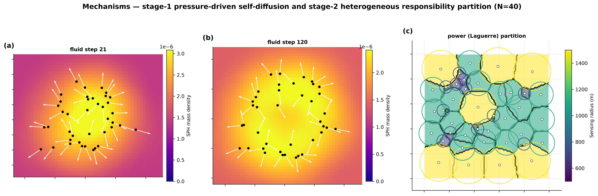
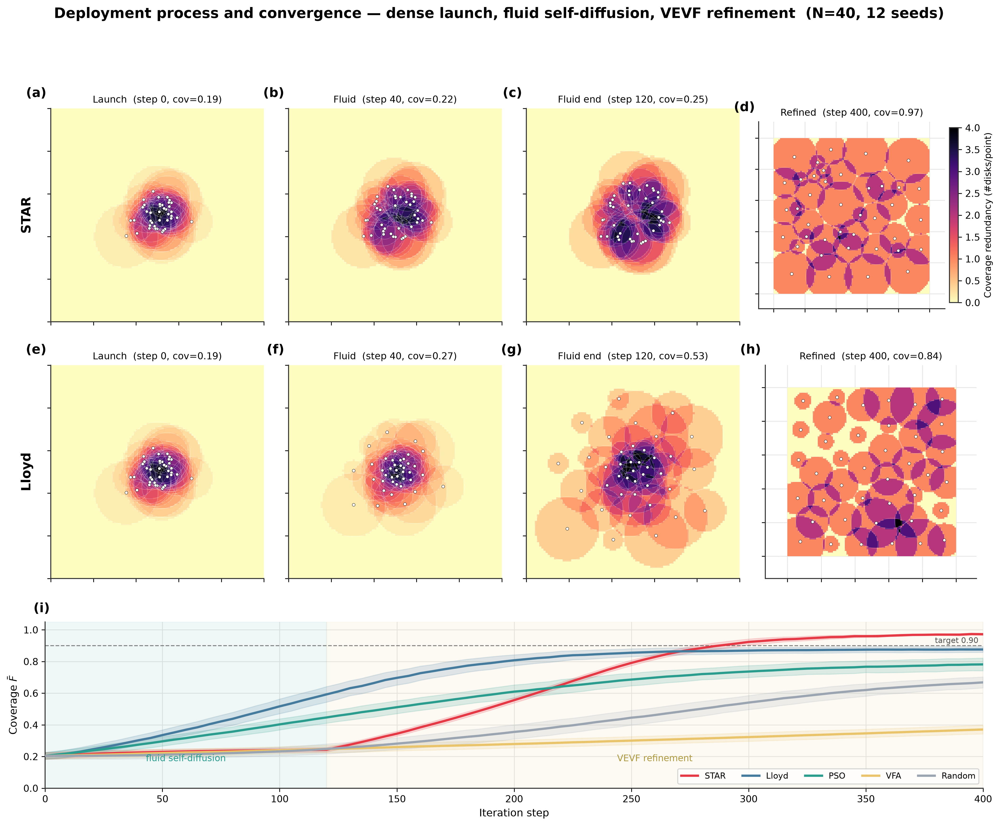
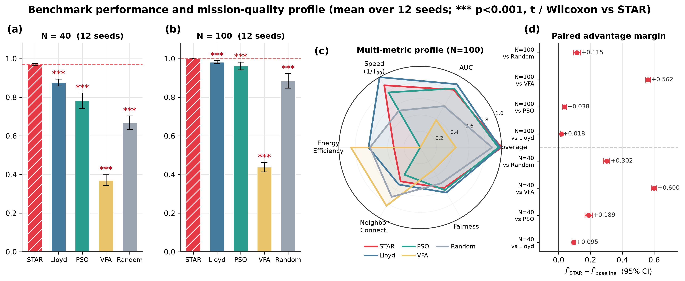
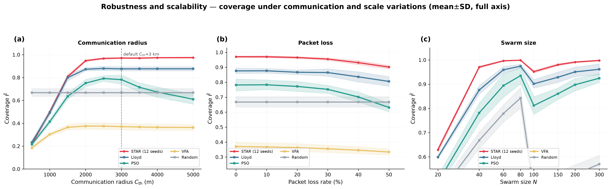
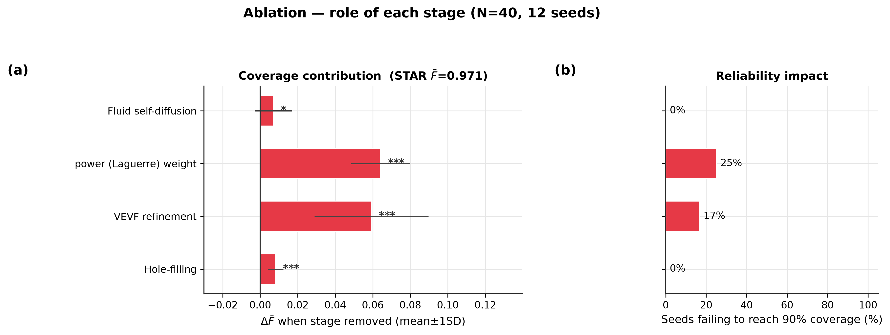
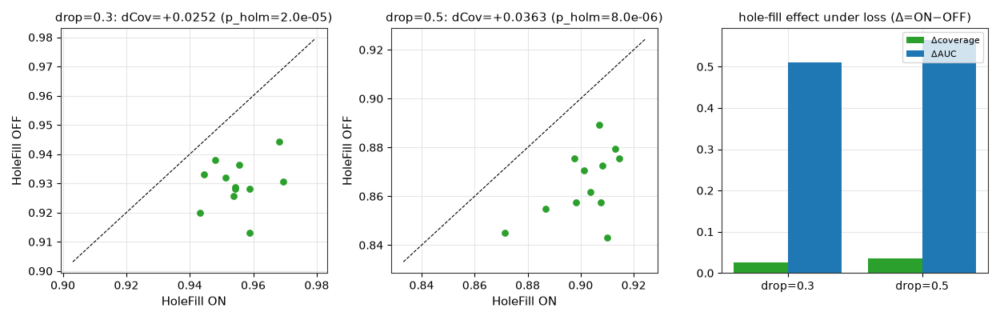
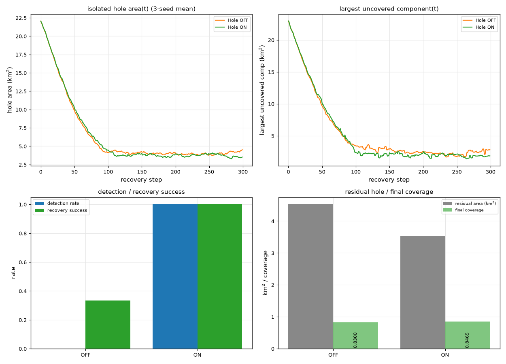
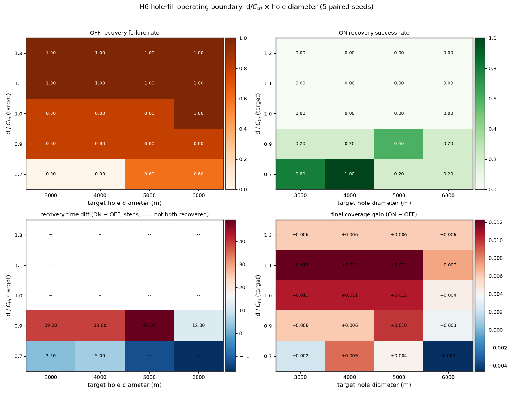
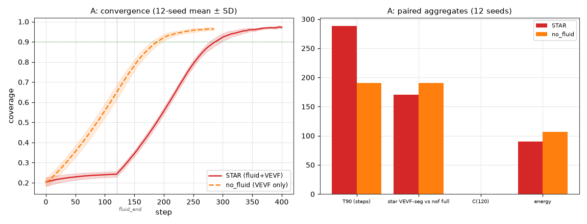
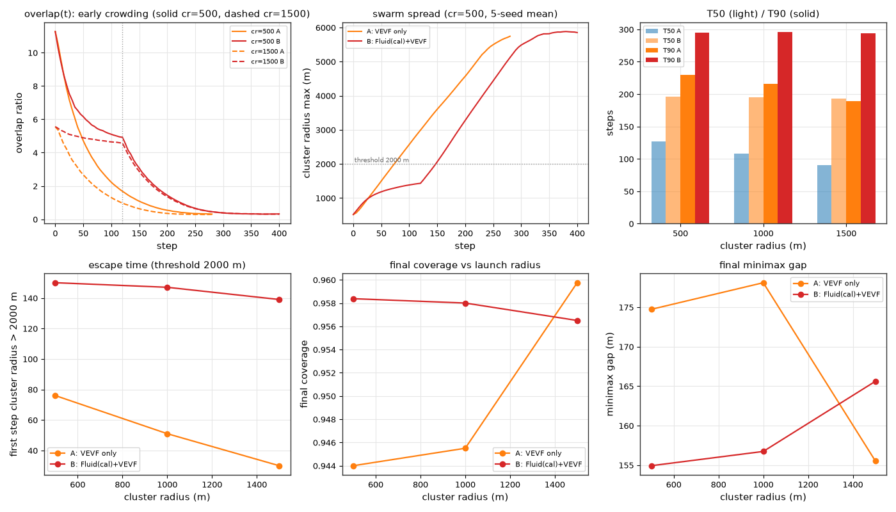

# Distributed Coverage Control for Heterogeneous USV Swarms with Local Geometric Optimization and Conditional Hole Recovery

**Authors**: Kexin Peng, Jiangang Jin, Bin Zeng

---

**Abstract**: Autonomous surface vehicle (USV) swarms deployed for maritime surveillance must reach near-complete coverage from a dense launch configuration while relying only on short-range, loss-prone communication, under which centralized coordination is impractical, yet existing coverage-control methods rely on global information, treat heterogeneous sensing capabilities identically, or lack mechanisms for recovering coverage defects under degraded communication. This paper presents a fully distributed coverage-control framework in which each USV acts solely on neighbor information within a communication radius $C_{th}$: local Laguerre (power) partitioning assigns responsibility commensurate with sensing radius, a vertex-edge virtual-force (VEVF) operator drives each USV toward the worst-covered point of its cell, and a distributed hole-recovery mechanism resolves conflicts among USVs competing for the same residual defect, optionally preceded by a density-gated diffusion front end that pre-decouples the launch cluster. In 12-seed paired experiments over a $10\,\mathrm{km}\times10\,\mathrm{km}$ area, the framework attains $0.971\pm0.005$ coverage at the near-critical density $N{=}40$ and $1.000$ at $N{=}100$, outperforming distributed Lloyd, VFA, PSO, and random walk, and retains $0.902$ coverage at a $50\%$ packet-loss rate. Controlled factorial experiments delimit the recovery mechanism's operating regime—the conditions under which defect recovery succeeds or fails—and position local geometric partitioning, not diffusion-style expansion, as the carrier of coverage performance.

**Keywords**: unmanned surface vehicle swarm; coverage control; Laguerre (power) diagram; virtual force; distributed hole recovery; communication constraints

---

## 1. Introduction

Large-area maritime surveillance—pollution tracking, harmful algal bloom detection, search and rescue, maritime patrol—demands sensing assets that are reconfigurable and cost-effective: autonomous aerial platforms (Shakhatreh et al., 2019) and maritime surface ships (Xu et al., 2024) exemplify such assets, which are further realized by networked sensing deployments (Ammari, 2010) and by USV-swarm navigation in restricted waters (Tan et al., 2019). USV swarms released from a mother platform are a flexible option: swarm-robotic behavior (Schranz et al., 2020) and unmanned-marine-vehicle cooperation (Bae and Hong, 2023) establish the paradigm, and USV-specific coordination—cooperative search and coverage (Zhao et al., 2023), heterogeneous collaborative observation (Kang et al., 2024), formation tracking (Wang et al., 2024), and surrounding control (Hu et al., 2022)—demonstrates it in the maritime domain. They nonetheless face a demanding deployment problem: starting from a dense launch configuration, the swarm must spread to near-complete coverage while each USV communicates only with neighbors within a limited radius, and while the fleet's payloads differ, so that per-USV detection radii are heterogeneous. Distributed operation is not a design preference here but a mission constraint: at the operating scales targeted in this paper (Section 4.1) the mission area far exceeds any single USV's communication radius, so a globally connected communication graph cannot be assumed at all times; centralized coordination would additionally concentrate traffic, computation, and failure risk on a single node, whose scalability and robustness drawbacks are well documented (Dorri et al., 2018).

These applications share a time-critical deployment primitive that this paper targets directly. In maritime-security exercises, USV fleets launched from a coastal staging area are expected to spread within minutes into a covering ring or sector around an area of interest, a rapid-response operating mode that naval unmanned-vehicle programs now treat as an explicit research theme (Chai et al., 2026; Huang et al., 2026b). Time-to-coverage is likewise the primary performance metric in maritime search and rescue, where unmanned surface vehicles extend the search fleet over an accident area (ICARUS, 2016); time-sensitive coverage-control formulations exist (Zhang et al., 2023), but they are developed for generic heterogeneous robots rather than for the dense-launch, limited-communication deployment of a USV swarm. The scenario studied here—a dense cluster that must spread to near-complete coverage while each unit acts on local, loss-prone information—is therefore not an artifact of a particular simulation but the common task primitive of these operational settings.

Existing approaches fall short in three respects. First, **heterogeneous allocation**: centroidal Voronoi/Lloyd methods (Cortés et al., 2004; Du et al., 1999) and their time-sensitive (Zhang et al., 2023) and resource-constrained heterogeneous extensions (Coffey and Pierson, 2023; Cao et al., 2023), as well as virtual-force schemes (Kiani and Soltani, 2022) and heuristic coverage planners (Tan et al., 2021; Muhsen et al., 2024), treat all agents identically, so sensing-capability disparities produce either blind spots or wasted overlap—the "barrier effect" of Euclidean partitioning. Weighted generalizations such as power (Laguerre) diagrams (Okabe et al., 2000; Aurenhammer, 1987) can encode radii directly in the distance function, and safe-coverage formulations for heterogeneous systems (Taylor et al., 2023) build on this structure, but most weighted-coverage controllers remain centralized or semi-distributed, requiring a global tessellation each iteration (Pratissoli et al., 2022; Wang et al., 2022); even communication-oriented ocean-observation frameworks (Kang et al., 2024) rely on networked rather than purely local coordination. Second, **fine-grained local optimization**: virtual-force methods (Kiani and Soltani, 2022; Tan et al., 2021) act locally but oscillate or self-lock when launched from a dense cluster, and stochastic methods (Muhsen et al., 2024; Zhang et al., 2015)—in particular PSO variants—typically need a global fitness signal. Third, **defect recovery under degraded communication**: residual coverage holes caused by lost USVs or flickering links are precisely the failures a distributed deployment must absorb, yet recovery is rarely treated as a first-class, communication-constrained mechanism (Section 2).

This paper proposes **STAR**, a fully distributed coverage-control framework that addresses all three gaps under a strict locality rule: every USV acts only on information from neighbors within $C_{th}$. The core is a two-part geometric controller—local Laguerre partitioning, which allocates responsibility commensurate with sensing radius, and a vertex-edge virtual-force (VEVF) operator, which pulls each USV toward the worst-covered point of its own cell. A distributed hole-recovery mechanism detects locally uncovered regions within a communication-clipped search window and resolves assignment conflicts; its value is gated by defect scale, isolation, and remaining fleet capacity, which we characterize experimentally. An optional density-gated diffusion front end pre-decouples the launch cluster; controlled experiments bound its benefit to end-state quality at extreme launch densities, never to convergence speed (Section 4.10).

The contributions are:

- **C1.** A fully distributed heterogeneous coverage controller combining local Laguerre partitioning with VEVF refinement, requiring no global center, grid, or assignment at any point of the control phase (Sections 3.3–3.4).
- **C2.** A validated local hole-recovery mechanism with a communication-clipped search window and conflict resolution, and an operating-regime analysis showing where recovery succeeds, where it is dispensable, and where fleet capacity—not the mechanism—is the binding constraint (Sections 3.4, 4.8).
- **C3.** A 12-seed paired evaluation across six suites plus factorial mechanism-boundary experiments, quantitatively separating each mechanism's benefit from its cost (Section 4).

These contributions are assessed under a configuration that matches the operating scale of deployed USVs rather than an idealized small-scale setting: a $10\ \mathrm{km}\times 10\ \mathrm{km}$ mission area, $40$--$100$ heterogeneous USVs with three sensing classes ($500$--$1500$ m), a $3$ km local communication radius (swept $500$--$5000$ m), a $400$-step budget at $20$ m per step, 12 paired seeds, four baselines under identical budgets and kinematics, and per-link packet loss up to $50\%$ (Section 4.1). This setup is grounded in documented operating scales of mid-size nearshore USVs and lets every comparison isolate each mechanism's benefit from its cost (Section 4).

The remainder of the paper reviews related work (Section 2), derives the method (Section 3), reports the experiments (Section 4), and discusses implications and limitations (Sections 5, 6).

## 2. Related Work

Recent work confirms that the deployment problem identified above remains open. Surveys of maritime USV swarm control published in 2025–2026 (Chai et al., 2026; Huang et al., 2026b) still list distributed deployment under degraded communication as an unresolved challenge, and the latest area-coverage studies for USV swarms address mission-level planning with centralized or model-based coordination (Yang et al., 2025) rather than the per-agent geometric control developed here.

### 2.1. Coverage Control and Heterogeneous Partitioning

The CVT formulation of Cortés et al. (2004) frames coverage as locational optimization over Voronoi cells, with Lloyd's algorithm (Du et al., 1999) as its standard distributed ascent; virtual-force methods (Kiani and Soltani, 2022) spread robots through artificial potentials, and heuristic coverage planners (Tan et al., 2021; Muhsen et al., 2024) are inherently local, at the cost of oscillation and self-locking in cluttered or asymmetric configurations; PSO (Muhsen et al., 2024; Zhang et al., 2015) offers a stochastic alternative but typically optimizes a global fitness. For heterogeneous sensing, power (Laguerre) diagrams generalize Voronoi via the power distance $d_L(\mathbf{p},i)=\lVert\mathbf{p}-\mathbf{x}_i\rVert^2-r_i^2$ (Okabe et al., 2000; Aurenhammer, 1987), yielding cell areas that grow with sensing radius; they underpin heterogeneous-coverage results for time-sensitive (Zhang et al., 2023) and resource-constrained settings (Coffey and Pierson, 2023), for range-limited robots (Pratissoli et al., 2022), and for heterogeneous disk-shaped robots (Arslan and Koditschek, 2016). Speed-heterogeneous coordination (Kim et al., 2022) and obstacle-aware distributed coverage (Cao et al., 2023; Mahboubi et al., 2012) extend these ideas but do not address recovery under degraded communication. These strands share two gaps that STAR addresses directly: the weighted tessellations of Cortés et al. (2004) and their range-limited (Pratissoli et al., 2022) and heterogeneous-disk (Arslan and Koditschek, 2016) extensions are computed globally or over a connected communication graph (Lloyd's own ascent is distributed but over the *Euclidean* diagram only (Du et al., 1999)), and none of them treats the recovery of coverage defects under lossy, radius-limited communication as part of the controller itself. Taylor et al. (2023) scale heterogeneous teams with limited connectivity to 100 agents, but their heterogeneity enters through safety constraints rather than sensing-radius-aware responsibility allocation, and recovery of coverage defects is not part of their controller.

### 2.2. USV Swarms and Communication Constraints

USV swarms have been applied to environmental monitoring (Tan et al., 2019) and aquaculture surveillance (Sousa et al., 2019); task-based hierarchical control (Qin et al., 2017), formation tracking (Wang et al., 2024), surrounding control (Hu et al., 2022), learning-based collision avoidance (Yin et al., 2024), and surveys of unmanned marine vehicles (Xu et al., 2024; Bae and Hong, 2023) emphasize autonomy and cooperation as open problems. Communication-constrained coordination has been studied for multi-robot patrol (Portugal and Rocha, 2013) and for coverage under topology changes and failures (Wang et al., 2022), and communications in multi-robot systems have been reviewed separately (Gielis et al., 2022). Two recent surveys sharpen the same gap from the control-theoretic side: Peng et al. (2021) note that most multi-USV coordinated-control results assume ideal communication and ignore packet loss, intermittent links, and range-limited channels, and explicitly call for distributed coordinated-control methods under such networked constraints; Chai et al. (2026) list unstable communication and heterogeneous platforms among the dominant open challenges. Centralized coordination structures incur communication traffic and single-point-of-failure risks that grow with fleet size (Dorri et al., 2018), which is precisely why distributed treatment matters for USV swarms. Within USV-specific coverage, the current state of the art is still built on centralized or globally computed structures: Zhao et al. (2023) combine a Voronoi partition with a centrally solved model-predictive planner for USV search coverage, and Gao et al. (2024) drive robotic surface vehicles to a centroidal Voronoi configuration under battery constraints, without a packet-loss model. Relative to this line, STAR treats deployment as a fully distributed control problem with per-link packet loss, quantifies coverage degradation from $0\%$ to $50\%$ loss with all methods under identical conditions, and adds the defect-recovery mechanism that Portugal and Rocha (2013), Gielis et al. (2022), and the USV-specific planners above do not consider.

## 3. Problem Formulation and Method

Figure 1 previews the two core mechanisms of the framework—the stage-1 density-pressure field that dissolves the dense launch cluster, and the stage-2 heterogeneous responsibility partition—together with the resulting deployment process; they are derived in Sections 3.2–3.4.

**Figure 1.** STAR mechanisms ($N=40$). **(a)** SPH mass-density field (color, $\mathrm{m}^{-2}$ scale $10^{-6}$) and per-USV pressure-force arrows (white) at fluid step 21: the dense cluster forms a high-density core whose gated pressure force (Eq. (6)) drives outward expansion. **(b)** At fluid step 120 the density field has homogenized toward the rest density and the net expansion forces vanish, terminating stage 1. **(c)** Stage-2 power (Laguerre) partition of the refined configuration: cell fill color encodes the owning USV's sensing radius $r_i$ (colorbar in m); circles show the sensing disks; larger-radius USVs tend to receive larger cells (design tendency, quantified by the allocation-fairness index of Section 3.6).

### 3.1. Problem Formulation

Let $\mathcal{U}=\{u_1,\dots,u_N\}$ denote a swarm of $N$ USVs deployed in a rectangular mission area $\Omega=[0,W]\times[0,H]\subset\mathbb{R}^2$. Each USV $u_i$ is characterized by its position $\mathbf{x}_i\in\Omega$, velocity $\mathbf{v}_i\in\mathbb{R}^2$, and sensing radius $r_i>0$. The sensing radius encodes the USV's detection capability, which depends on its payload; a point $\mathbf{p}\in\Omega$ is said to be *covered* by USV $u_i$ if $\lVert\mathbf{p}-\mathbf{x}_i\rVert\le r_i$.

**Assumption 1 (Local sensing and communication).** Each USV can observe the relative position, velocity, and sensing radius of any other USV within a communication radius $C_{th}$. It has no access to global information: no central controller, no global map, no global tessellation.

**Assumption 2 (Discrete-time kinematics).** USVs evolve in discrete time with step $\Delta t$ and a maximum speed $v_{\max}$:

$$\mathbf{v}_i(k+1) = \operatorname{clip}\!\left(\mathbf{v}_i(k) + \mathbf{F}_i(k)\,\Delta t,\; v_{\max}\right), \qquad \mathbf{x}_i(k+1) = \mathbf{x}_i(k) + \mathbf{v}_i(k+1)\,\Delta t, \tag{1}$$

where $\mathbf{F}_i(k)$ is the total force on USV $u_i$ at step $k$, and $\operatorname{clip}(\mathbf{u},v_{\max})$ saturates the speed: $\operatorname{clip}(\mathbf{u},v_{\max})=\mathbf{u}$ if $\lVert\mathbf{u}\rVert\le v_{\max}$ and $(v_{\max}/\lVert\mathbf{u}\rVert)\mathbf{u}$ otherwise.

**Assumption 3 (Initial condition).** The swarm is launched from a dense configuration, modeled as a Gaussian cluster centered at the area center with standard deviation $\sigma_{launch}$.

In a conventional Voronoi tessellation, responsibility is assigned by Euclidean distance: every point of $\Omega$ is served by the nearest USV. This rule implicitly assumes identical sensing capabilities, so under heterogeneous sensing radii the Euclidean nearest USV is not necessarily the most appropriate caretaker of a given point—a farther high-capacity USV may cover a point that a nearer low-capacity USV cannot. Spatial allocation must therefore incorporate the sensing heterogeneity itself, which motivates the power-distance (Laguerre) partition of Section 3.4.

We state the control problem as a multi-objective design target rather than a single jointly optimized objective, because the individual criteria can conflict: raising coverage may require additional travel, and a fairer allocation does not by itself guarantee higher coverage within a finite control horizon. The design targets are: the *primary task metric*, the final coverage ratio $C(K)$ of Eq. (2); the *allocation-quality metric*, the fairness of the responsibility partition relative to sensing demand (each USV's cell should reflect its sensing capability); the *operating constraints*, local communication (each USV uses only neighbor information within $C_{th}$, Assumption 1), the speed limit $v_{\max}$, and a finite step budget $K$; and the *robustness requirement*, that under communication loss the controller uses only the neighbor information available at the current step. These targets serve as design goals and evaluation criteria and are not synthesized into a single objective function. Accordingly, we do not claim to solve a joint optimization with global optimality guarantees; instead, we design a staged heuristic controller—compressible-fluid diffusion, local Laguerre partitioning, and vertex-edge virtual forces (Sections 3.2–3.4)—that pursues the targets above under strictly local information, starting from the dense launch configuration of Assumption 3.

We quantify coverage with a grid-based estimator. Let $\mathcal{G}\subset\Omega$ be a uniform evaluation grid with resolution $\delta_g$ and $|\mathcal{G}|$ points. The coverage ratio at step $k$ is

$$C(k) = \frac{\left\lvert\left\{\mathbf{g}\in\mathcal{G} : \exists i,\ \lVert\mathbf{g}-\mathbf{x}_i(k)\rVert\le r_i\right\}\right\rvert}{\lvert\mathcal{G}\rvert}. \tag{2}$$

We define the redundancy ratio

$$\rho=\frac{\sum_{i=1}^{N}\pi r_i^2}{WH}, \tag{3}$$

which indicates whether the total sensing area is ample ($\rho\gg 1$) or near-critical ($\rho\gtrsim 1$). In the near-critical regime, any misallocation of responsibility directly creates blind spots, which is why partitioning quality matters most there.

The grid estimate in Eq. (2) is a discrete sampling of the continuous coverage region: a sensing disk contributes a grid point only if that point lies inside the disk. Whether the estimate over- or under-estimates the true continuous coverage depends on how grid points straddle disk boundaries and on the sampling rule, so we do not claim a rigorous error bound for the absolute value. What the identical grid and evaluation protocol do guarantee is that any sampling bias is common-mode across all methods, which is what the between-method comparisons of Section 4 require. Absolute coverage levels should therefore be read as grid-sample estimates rather than exact continuous coverage; polygon-exact evaluation was not performed.

### 3.2. Stage 1: Compressible-Fluid Self-Diffusion

Stage 1 addresses the local crowding that results from the dense launch configuration (Assumption 3), in which the sensing disks of neighboring USVs overlap substantially. The responsibility partition of Stage 2 (Section 3.3) is computed from the current positions, so a direct geometric refinement from the dense cluster would first have to escape the local crowding: at the cluster core the local cells are tiny and highly elongated, and the VEVF forces of Stage 3 (Section 3.4) would push USVs outward while their cells are still degenerate. Stage 1 is therefore a preprocessing step whose goal is not to optimize coverage but to *thin the local crowding*: to spread the swarm so that the cells of Stage 2 are non-degenerate and the geometric stages start from a meaningful partition. We model this spreading as the self-diffusion of a compressible fluid, following the smoothed-particle hydrodynamics (SPH) methodology (Monaghan, 2005): each USV is treated as a fluid parcel whose motion is driven by local density gradients.

The *local density* of USV $u_i$ is estimated from its neighbors using a cubic-spline kernel:

$$\rho_i = W(\mathbf{0}) + \sum_{j\in\mathcal{N}_i^{h}} W(\mathbf{x}_j-\mathbf{x}_i), \tag{4}$$

where $\mathcal{N}_i^{h}=\{j : \lVert\mathbf{x}_j-\mathbf{x}_i\rVert< h,\ j\neq i\}$ is the neighbor set within the interaction radius $h$, and the kernel is

$$W(\mathbf{r}) = \frac{1}{\pi h^2}\left(1-\frac{3}{2}q^2+\frac{3}{4}q^3\right),\qquad q=\frac{\lVert\mathbf{r}\rVert}{h}\in[0,1], \tag{5}$$

with $W(\mathbf{0})=\frac{1}{\pi h^2}$ the self-contribution so that an isolated USV has positive density, and $W(\mathbf{r})=0$ for $\lVert\mathbf{r}\rVert>h$ (the kernel is truncated at $q=1$). Here $q=\lVert\mathbf{r}\rVert/h$ is the normalized (dimensionless) distance from the kernel center; the polynomial in Eq. (5) is the first branch ($0\le q\le1$) of the standard cubic-spline kernel of smoothed-particle hydrodynamics (Monaghan, 2005), and the coefficients $3/2$ and $3/4$ are those of that canonical form. With the normalization constant $1/(\pi h^2)$ and the truncation at $q=1$, the kernel does not integrate to unity in two dimensions; because the density of Eq. (4) is only a weighted count and the absolute density scale is absorbed by the force-scale calibration of $k_{fluid}$ (below), this does not affect the reported results. The kernel converts the neighbor distribution into a scalar density: the more neighbors within $h$ and the closer they are, the larger $\rho_i$. The interaction radius $h$ therefore sets the *neighborhood scale* over which crowding is sensed. The pressure follows an isothermal equation of state with a *rest-density gate* $\rho_0$,

$$p_i = k_{fluid}\,\max\!\left(\frac{\rho_i}{\rho_0}-1,\;0\right),\qquad \mathbf{F}_i^{pres} = -\sum_{j\in\mathcal{N}_i^{h}} \frac{p_i+p_j}{2\,\rho_j}\,\nabla W(\mathbf{x}_i-\mathbf{x}_j), \tag{6}$$

where $p_i$ is the pressure scalar of USV $u_i$, $\mathbf{F}_i^{pres}$ the total pressure (repulsive) force on $u_i$ from its kernel neighbors, $k_{fluid}$ the pressure gain, and $\nabla W(\mathbf{r}) = \frac{-3q+2.25q^2}{\pi h^4}\cdot\frac{\mathbf{r}}{\lVert\mathbf{r}\rVert}\le 0$ along $\mathbf{r}=\mathbf{x}_i-\mathbf{x}_j$ is the kernel gradient. The quantities $p_j$ and $\rho_j$ in the denominator are the pressure and density of the neighbor $u_j$ as estimated from $u_i$'s local view (detailed below). The gate makes the pressure *one-sided*: compression ($\rho_i>\rho_0$) produces a repulsive force directed from $j$ toward $i$, whereas an under-dense neighborhood ($\rho_i\le\rho_0$) exerts no pressure at all. Thus $\rho_0$ encodes the target packing density toward which the stage drives, and $k_{fluid}$ sets how strongly a given excess density is converted into motion.

Eq. (6) is the exact formula implemented in the release code: the density of Eq. (4), the gate of the first line of Eq. (6), and the pairwise sum with the *neighbor* density $\rho_j$ in the denominator (second line) are reproduced line by line. Two points deserve emphasis. First, the denominator uses $\rho_j$—the density of the neighbor as estimated from $u_i$'s local view—rather than the average $(\rho_i+\rho_j)/2$ of the standard SPH formulation; this is the form actually implemented. Second, the pairwise sum is exactly symmetric only if $\rho_j$ is exact. In the fully distributed implementation, $\rho_j$ is approximated from $u_i$'s broadcast neighbor table, $\rho_j \approx W(\mathbf{0}) + W(\mathbf{x}_j-\mathbf{x}_i) + \sum_{k\in\mathcal{N}_i^{h}\setminus j} W(\mathbf{x}_k-\mathbf{x}_j)$, clipped below at $W(\mathbf{0})$ for numerical safety. This is a local estimate that ignores the neighbors of $j$ lying outside $u_i$'s communication range, and it uses only the already-broadcast positions and radii—no additional communication rounds. In a two-USV system the estimate is exact and action equals reaction; in larger swarms it is a purely local underestimate, and the realized forces are only approximately pairwise-symmetric. We therefore distinguish three levels of claims: the standard SPH theory guarantees exact pairwise symmetry and global momentum conservation; the local approximation used here does not inherit those guarantees; what it buys is strictly local computation and communication (no global tessellation, no extra message passing) at the cost of that exact symmetry. The empirical consequences are examined in the fluid ablation of Section 4.10.

An XSPH-style viscosity damps relative motion:

$$\mathbf{F}_{ij}^{vis} = \mu\, W(\mathbf{x}_j-\mathbf{x}_i)\,(\mathbf{v}_j-\mathbf{v}_i), \tag{7}$$

where $\mathbf{F}_{ij}^{vis}$ is the viscous force that neighbor $u_j$ exerts on $u_i$, with $\mu$ the viscosity coefficient; it counteracts the jitter that a pressure-only expansion would induce by pulling each USV toward the mean motion of its kernel neighbors. A quadratic drag $\mathbf{F}^{drag}=-c_d\lVert\mathbf{v}_i\rVert\mathbf{v}_i$ dissipates the excess kinetic energy of the launch so that the swarm settles rather than oscillates, and an ROI boundary spring $\mathbf{F}_i^{bnd}$ keeps USVs inside $\Omega$. The total Stage-1 force on USV $u_i$ is

$$\mathbf{F}_i^{(1)} = \mathbf{F}_i^{pres} + \sum_{j\in\mathcal{N}_i^{h}}\mathbf{F}_{ij}^{vis} - c_d\lVert\mathbf{v}_i\rVert\mathbf{v}_i + \mathbf{F}_i^{bnd}, \tag{8}$$

and enters the discrete-time kinematics of Eq. (1) as the total force $\mathbf{F}_i$ during this stage.

The rest-density gate makes the expansion *self-limiting* in the sense that an under-dense neighborhood exerts no pressure—but this does *not* imply that the swarm reaches a globally uniform density, nor that coverage is optimal at the end of the stage: the pressure vanishes locally once each neighborhood drops to $\rho_0$, which can leave residual spatial non-uniformity, and nothing in the stage optimizes the coverage metric of Eq. (2). In practice the stage is run for a *fixed budget* $N_{fluid}=120$ steps (Table 3), which is part of the total control horizon $K$; the preprocessing therefore consumes budget that the geometric stages cannot use. Empirically (Section 4.10) the stage does not de-crowd faster than VEVF under an equal step count; its value is a modest end-state improvement under the specific dense-launch condition, at an additional time cost. We therefore regard Stage 1 as an *optional preprocessing mechanism for the dense initial condition*, not as the main theoretical basis for the algorithm's overall performance.

The absolute scale of $\mathbf{F}^{pres}$ depends on the particle-mass units of the kernel, and $k_{fluid}$ was fixed by a force-scale calibration rather than by any coverage-based tuning. The calibration compares the mean pressure-force magnitude of the literal SPH implementation (unit masses, $k_{fluid}=350$ in the same units) against the legacy heuristic force that the fluid stage replaced: a force probe over the launch configurations measures the ratio of the two mean force magnitudes, which was $5533$, and $k_{fluid}$ was set to $350\times5533=1.9367\times10^6$ so that the mean force magnitude matches the legacy baseline. The reference quantity is therefore the *mean force magnitude*, not coverage or any other target metric, and the value is the one reported in Table 3. The robustness of the reported results to this value is examined in the $k_{fluid}$ sweep of Section 4.10. A consolidated symbol table is provided in Table 2.

### 3.3. Stage 2: Local Laguerre (Power) Partitioning

After diffusion, we assign each USV a responsibility region using the power (Laguerre) diagram, which accounts for heterogeneous sensing radii. The *power distance* between a point $\mathbf{p}$ and USV $u_i$ is

$$d_L(\mathbf{p},i) = \lVert\mathbf{p}-\mathbf{x}_i\rVert^2 - r_i^2. \tag{9}$$

The Laguerre cell of USV $u_i$ is

$$\mathcal{V}_i = \Omega \cap \bigcap_{j\in\mathcal{N}_i^{C}} \left\{\mathbf{p}\in\mathbb{R}^2 : d_L(\mathbf{p},i) \le d_L(\mathbf{p},j)\right\}. \tag{10}$$

where $\mathcal{N}_i^{C}$ is the set of neighbors of $u_i$ within the communication radius $C_{th}$.

Expanding the inequality $d_L(\mathbf{p},i)\le d_L(\mathbf{p},j)$ yields a half-plane constraint on $\mathbf{p}$ (Eq. (11)):

$$2(\mathbf{x}_j-\mathbf{x}_i)^{\top}\mathbf{p} \;\le\; \left(\lVert\mathbf{x}_j\rVert^2 - r_j^2\right) - \left(\lVert\mathbf{x}_i\rVert^2 - r_i^2\right). \tag{11}$$

The sensing radius enters the power distance as an additive offset: at fixed positions, a larger $r_i$ moves the boundary with a rival $u_j$ away from $u_i$, so a USV with more sensing capability wins a larger share of the plane. This is the *design tendency* that motivates the weighted partition—it is not a universal guarantee: in an arbitrary configuration the realized cell area also depends on the local arrangement of neighbors and need not be exactly proportional to $r_i^2$. The tendency is the one visualized in Figure 1c and quantified through the allocation-fairness index $J$ of Section 3.6 (Eq. (21)), which scores how close the realized cell areas come to proportional allocation ($A_i\propto r_i^2$). Removing the barrier effect of Euclidean partitioning (Arslan and Koditschek, 2016) is precisely what this weighted competition achieves: the Euclidean boundary is blind to sensing capability, whereas the power boundary is not.

In the fully distributed setting, only neighbors within $C_{th}$ participate in the cell construction: $\mathcal{V}_i$ is built from the half-planes of the set $\mathcal{N}_i^{C}$ (distinct from the kernel-range set $\mathcal{N}_i^{h}$ of Section 3.2), and the ROI itself closes the cell where no neighbor constrains it. The half-planes are applied in ascending neighbor distance order for computational efficiency: near neighbors clip first, so the cell closes quickly and weakly-constraining distant neighbors are often never evaluated. Three consequences follow. First, the local cell is a *superset* of the global Laguerre cell: half-planes from USVs beyond $C_{th}$ are omitted, so boundaries that a global diagram would impose are absent and responsibility regions can overlap slightly near the communication horizon; for the dense swarms studied here the two diagrams coincide except close to the ROI boundary. Second, a cell can fail to close or collapse: when the intersection of the ROI with the retained half-planes is empty or has area below a numerical threshold, the cell is flagged as *empty*; the USV keeps only the fallback quantities (centroid and MiniMax point collapse to its own position, covering radius zero), Stage 3 applies no geometric force to it (Section 3.4), and such USVs are excluded from the fairness statistics as sensing-redundant by design (Section 3.6). Third, the local construction preserves the geometric structure of the weighted partition—every retained constraint is still a true half-plane of the power distance—so the allocation quality measured on local cells is the same quantity a global diagram would produce, only with fewer constraints.

For each cell we compute, using only local geometry:

- the **cell centroid** $\mathbf{c}_i = \frac{1}{|\mathcal{V}_i|}\int_{\mathcal{V}_i}\mathbf{p}\,\mathrm{d}\mathbf{p}$;
- the **covering radius** $\hat{r}_i = \max_{\mathbf{p}\in\partial\mathcal{V}_i}\lVert\mathbf{p}-\mathbf{x}_i\rVert$, the farthest distance from the USV to its cell boundary;
- the **MiniMax point** $\mathbf{m}_i$, an iteratively refined approximation of the minimum-enclosing-circle center of the cell vertices, which minimizes the worst-case distance to any cell point.

These three quantities are *control references* for Stage 3, not a global optimal-coverage solution. The centroid $\mathbf{c}_i$ is the geometric center of the responsibility region and the target of the centroid spring of Eq. (13), a Lloyd-like bias that keeps the USV centered in its cell. The MiniMax point $\mathbf{m}_i$ tracks the worst-case distance inside the cell (the center of the smallest enclosing circle of the cell vertices) and is the target of the vertex force of Eq. (12), which pulls the USV away from its farthest reachable boundary. The covering radius $\hat{r}_i$ measures whether the USV's sensing disk suffices to cover the responsibility region: $\hat{r}_i>r_i$ indicates cell points beyond sensing range, and this gap is aggregated as the minimax gap $G$ of Section 3.6. Together these quantities drive the VEVF forces and the hole-filling trigger of Section 3.4; the final partition is the outcome of the distributed dynamics, not a globally optimal covering.

### 3.4. Stage 3: Distributed VEVF Refinement and Conditional Hole Recovery

Stage 3 is the basic controller executed at every step: each USV refines its position inside its responsibility cell. Hole filling is a separate, *conditional* behavior that a USV activates only when its local window contains uncovered sample points. The two mechanisms are therefore presented as distinct sub-stages below: VEVF is always on, hole filling is triggered.

#### 3.4.1. VEVF-based Geometric Refinement

For each USV $u_i$ with non-empty cell $\mathcal{V}_i$, we define three forces, each with a distinct design motive:

1. *Vertex (MiniMax) force*: pull $u_i$ toward the center of the smallest circle enclosing the cell vertices,

$$\mathbf{F}_i^{v} = \min\!\left(\frac{k_v\,\lVert\mathbf{d}_i^{mm}\rVert}{10^3},\; f_{\max}\right)\frac{\mathbf{d}_i^{mm}}{\lVert\mathbf{d}_i^{mm}\rVert},\qquad \mathbf{d}_i^{mm} = \mathbf{m}_i-\mathbf{x}_i; \tag{12}$$

The MiniMax point $\mathbf{m}_i$ minimizes the worst-case distance to any cell point, so this force acts on the *worst-covered* part of the responsibility region: it moves the USV to a position from which the farthest reachable cell point is as close as possible.

2. *Centroid spring*: pull $u_i$ toward its cell centroid, governed by Eq. (13),

$$\mathbf{F}_i^{c} = \min\!\left(\frac{k_c\,\lVert\mathbf{d}_i^{c}\rVert}{10^3},\; f_{\max}\right)\frac{\mathbf{d}_i^{c}}{\lVert\mathbf{d}_i^{c}\rVert},\qquad \mathbf{d}_i^{c} = \mathbf{c}_i-\mathbf{x}_i; \tag{13}$$

The centroid attraction provides the overall position bias within the cell: it pulls the USV toward the geometric center of its responsibility region, preventing it from lingering near one side. It is a Lloyd-like term—converging toward the cell centroid, as in Lloyd's algorithm—but computed on the *local* cell (recomputed every step from neighbor information only) rather than on a global Voronoi tessellation.

3. *Edge force*: pull $u_i$ toward the midpoint of its farthest cell edge (gap filling),

$$\mathbf{F}_i^{e} = \min\!\left(\frac{k_e\,\lVert\mathbf{d}_i^{e}\rVert}{10^3},\; f_{\max}\right)\frac{\mathbf{d}_i^{e}}{\lVert\mathbf{d}_i^{e}\rVert}, \tag{14}$$

where $\mathbf{d}_i^{e}$ points from $\mathbf{x}_i$ to the farthest edge midpoint of $\mathcal{V}_i$. The target is selected by computing the midpoints of the cell edges (from consecutive cell vertices) and keeping the one farthest from the USV; this edge is the boundary segment where the sensing disk is thinnest relative to the cell, so moving toward it directly thickens the weakest part of the boundary coverage.

Each force is clipped at $f_{\max}$ ($\min(\cdot,f_{\max})$), which limits the per-component control input of a single step and, together with the velocity cap $v_{\max}$ of Eq. (1), prevents large displacements from causing overshoot or oscillation. The total Stage-3 force on USV $u_i$ is

$$\mathbf{F}_i^{(3)} = \mathbf{F}_i^{v} + \mathbf{F}_i^{c} + \mathbf{F}_i^{e} + \mathbf{F}_i^{hole}. \tag{15}$$

Here $k_v,k_c,k_e$ are vertex/centroid/edge gains (force per km of displacement), $f_{\max}$ the per-USV force limit, and $k_{target}$ the hole-filling gain; $\mathbf{F}_i^{hole}$ is the hole-filling force of Section 3.4.2, directed toward the candidate target with magnitude $\min(k_{target}\lVert\mathbf{d}\rVert/10^3,\,f_{\max})$, where $\mathbf{d}$ is the displacement from $\mathbf{x}_i$ to that target. The factor $10^3$ in the denominators of Eqs. (12)--(14) converts the displacement, which is measured in meters, to kilometers so that the gains take the stated per-km units.

The superposition of the three forces is a heuristic control law: it does not guarantee that coverage increases monotonically at every step (the cell is recomputed from the new positions, so a boundary shift can temporarily reduce local coverage), and it is not a proof of convergence to a globally optimal covering. Its properties are established empirically in Section 4.

#### 3.4.2. Local Hole Detection and Conditional Recovery

Hole recovery is a chain of four distinct stages—*detection, assignment, movement, and successful recovery*—and success at an earlier stage does not imply success at a later one. The chain is executed as follows.

1. *Detection window*: sample a local grid $\mathcal{G}_i^{local}$ inside a disk of radius $r_{eff}=\min(R_{search}, C_{th})$ around the USV position, where $R_{search}$ is a configuration bound.
2. *Coverage screening*: retain only sample points not covered by the USV's own sensing disk or by any neighbor's disk.
3. *Candidate selection*: the remaining points form the uncovered set $\mathcal{U}_i$,

$$\mathcal{U}_i = \left\{\mathbf{g}\in\mathcal{G}_i^{local} : \lVert\mathbf{g}-\mathbf{x}_i\rVert\le r_{eff},\ \lVert\mathbf{g}-\mathbf{x}_i\rVert>r_i \ \wedge\ \forall j\in\mathcal{N}_i^{C},\ \lVert\mathbf{g}-\mathbf{x}_j\rVert>r_j\right\}, \tag{16}$$

and the nearest element of $\mathcal{U}_i$ is chosen as the candidate target.

4. *Assignment by conflict rule*: if a neighbor $u_j$ targets a nearly identical hole (within a conflict radius) and is closer to it, USV $u_i$ defers; ties are broken by the stable lower-index rule. This rule coordinates USVs that can communicate with each other; USVs beyond mutual communication range are not coordinated by it.
5. *Movement and re-evaluation*: the USV moves toward the target with force $\min(k_{target}\lVert\mathbf{d}\rVert/10^3, f_{\max})$, where $\mathbf{d}$ is the displacement from $\mathbf{x}_i$ to the candidate target, and the coverage state is re-evaluated in subsequent control steps (a filled point disappears from $\mathcal{U}_i$ once covered).

The detection is grid-resolution-sampled: a "hole" is an uncovered region at the sampling scale of $\mathcal{G}_i^{local}$.

First, *communication reachability is not sensor observability*: the $C_{th}$ clip in $r_{eff}$ guarantees that any target lies within communication range, so a USV never chases a target it cannot communicate with; the local grid, however, is computed by the simulator from the global state, not observed by a physical sensor, and we do not claim sensor-level perception of the targets. Second, the conflict rule resolves competition *only among mutually communicating USVs*; USVs beyond each other's communication range may still select the same hole, so we do not claim a global guarantee that every hole is assigned to exactly one USV. Third, *detection does not imply recovery*: even a 100% detection rate does not guarantee success, because the remaining fleet may lack the sensing capacity or the hole may be too large to fill.

Reasoning about recovery must keep four assertions apart; our experiments evaluate them separately. (i) *Empty local cell*: a partitioning artifact in which $\mathcal{V}_i$ is degenerate; it is neither necessary nor sufficient for filling to help. (ii) *Local deficit (detection)*: $\mathcal{U}_i\neq\emptyset$—the trigger above; it is necessary but not sufficient for recovery. (iii) *Isolation*: the defect's center lies beyond every USV's communication radius; detection still succeeds through the defect's near edge, but no USV perceives the defect as a whole, and recovery proceeds by approach rather than in one hop. (iv) *Remaining capacity*: whether the fleet, after the losses that created the defect, retains enough total coverage area to fill it while holding its outer responsibilities. Conditions (ii)–(iii) gate whether hole filling is useful; (iv) bounds whether recovery is physically possible at all. Section 4.8 measures all four mechanisms.

The factorial experiments of Sections 4.8 and 4.9 show that the benefit of hole filling depends on the hole scale, the degree of isolation, and the remaining fleet capacity; the clearest improvements in success rate are confined to a narrow range of conditions. Hole filling is therefore best understood as a *conditionally triggered local recovery mechanism*, not as a universally effective hole repairer.

### 3.5. Overall Algorithm and Baselines

The complete deployment runs Stage 1—an *optional* preprocessing front end (Section 3.2)—for $N_{fluid}$ steps, then Stages 2+3 for $N_{evfa}$ steps. At every Stage-3 step, each USV rebuilds its local Laguerre cell from the *current* neighbor state, evaluates the VEVF forces, and superimposes the hole-filling force only when the local-deficit trigger holds *and* the conflict rule assigns that hole to it (Section 3.4.2). The framework is fully distributed in the control phase: each USV's force depends only on neighbor information and its own local cell. The overall procedure is summarized in Algorithm 1, and the module-level input–output structure is given in Table 1.

The control loop is *synchronous*: at every step each USV broadcasts a fixed-size message—its position, velocity, and sensing radius (5 scalars, $\approx$40 bytes in double precision, plus protocol header)—and receives the same from all neighbors within $C_{th}$. Neighbor discovery itself requires no infrastructure: in deployment it reduces to filtering incoming broadcasts by range; the cKD-tree used in the simulator ($O(N\log N)$) is an implementation accelerator only and is not part of the control semantics. Packet loss is *modeled in simulation* as independent per-link Bernoulli drops with rate $p$: a lost link is simply *absent for that step*—neighbors are not replaced by stale cached values, so the controller is conservative under loss (it acts on fewer neighbors rather than on outdated ones). This is a simulation model adopted for tractability and reproducibility, not a general assumption about maritime radio behavior: real links exhibit correlated fading, interference, and retransmission that we do not attempt to model. Per USV and step, the always-on base controller costs $O(k)$ in the neighbor count $k$: kernel sums in Stage 1 ($k$ terms), $k$ half-plane clips for the local Laguerre cell in Stage 2, and cell-vertex force evaluation in Stage 3. Hole filling adds a *sampling* cost that is not constant: the local grid contains $O\!\big((r_{eff}/g)^2\big)$ candidate sample points, where $g$ is the hole-detection grid resolution, and screening each candidate against the neighbor disks costs $O\!\big((r_{eff}/g)^2\,k\big)$ in the worst case—incurred only by the filling USVs and only when the trigger fires. The two costs should be read separately: $O(k)$ for the always-on refinement, and $O\!\big((r_{eff}/g)^2\big)$ candidates per triggered filling episode. No global quantities, no global data structures, and no inter-neighbor relaying are used at any point of the control loop. All coverage ratios, statistics, and diagrams reported in Section 4 are *offline* evaluations: the global evaluation grid $\mathcal{G}$ of Eq. (2), the coverage curves, and the energy and fairness statistics are computed by the simulator on the full system state after the episode and are *not* available to any controller during deployment. The only grid data inside the control loop are the local grids $\mathcal{G}_i^{local}$ of Eq. (16); the distributed claim concerns the control law, not the evaluation.

**Algorithm 1.** Fully distributed STAR deployment (per USV $u_i$).

| **Input:** position $\mathbf{x}_i(0)$, sensing radius $r_i$, communication radius $C_{th}$, time step $\Delta t$, speed cap $v_{\max}$, stage budgets $N_{fluid}$, $N_{evfa}$; parameters: interaction radius $h$, rest density $\rho_0$, pressure gain $k_{fluid}$, viscosity $\mu$, drag $c_d$, gains $k_v$, $k_c$, $k_e$, $k_{target}$, force cap $f_{max}$ |
|---|
| **Output:** deployment $\{\mathbf{x}_i(K)\}$, $K=N_{fluid}+N_{evfa}$ |
| 1: broadcast state; receive neighbor set $\mathcal{N}_i^{C}$ within $C_{th}$ |
| 2: **for** $k=1$ **to** $N_{fluid}$ **do** ▷ Stage 1: fluid diffusion (optional front end) |
| 3: &nbsp;&nbsp;&nbsp;&nbsp;compute density $\rho_i$ (Eq. (4)) and force $\mathbf{F}_i^{(1)}$ (Eq. (8)) |
| 4: &nbsp;&nbsp;&nbsp;&nbsp;integrate kinematics (Eq. (1)); broadcast |
| 5: **end for** |
| 6: **for** $k=1$ **to** $N_{evfa}$ **do** ▷ Stages 2+3: partition + VEVF |
| 7: &nbsp;&nbsp;&nbsp;&nbsp;rebuild local Laguerre cell $\mathcal{V}_i$ from current neighbor state (Eq. (10)) |
| 8: &nbsp;&nbsp;&nbsp;&nbsp;**if** $\mathcal{V}_i\neq\emptyset$ **then** compute $\mathbf{m}_i,\mathbf{c}_i$; forces $\mathbf{F}_i^v,\mathbf{F}_i^c,\mathbf{F}_i^e$ (Eqs. (12)–(14)) |
| 9: &nbsp;&nbsp;&nbsp;&nbsp;compute local deficit $\mathcal{U}_i$ (Eq. (16)); **if** assigned by conflict resolution **then** add $\mathbf{F}_i^{hole}$ |
| 10: &nbsp;&nbsp;&nbsp;&nbsp;integrate kinematics (Eq. (1)); broadcast |
| 11: **end for** |
| 12: **return** $\{\mathbf{x}_i(K)\}$ |

**Table 1.** Module-level summary: inputs, outputs, trigger, run frequency, and key parameters of each control module.

| Module | Inputs | Outputs | Trigger | Frequency | Key parameters |
|---|---|---|---|---|---|
| Fluid diffusion (Stage 1) | neighbor positions within $h$ | local density $\rho_i$; force $\mathbf{F}_i^{(1)}$ (Eq. (8)) | always (optional front end) | every step of $N_{fluid}$ | $h$, $\rho_0$, $k_{fluid}$, $\mu$, $c_d$ |
| Local Laguerre cell (Stage 2) | own and neighbor positions/radii within $C_{th}$; ROI | cell $\mathcal{V}_i$; $\mathbf{c}_i$, $\mathbf{m}_i$, $\hat{r}_i$ | always | every step of $N_{evfa}$ | $C_{th}$ |
| VEVF refinement | local cell; own position | $\mathbf{F}_i^v$, $\mathbf{F}_i^c$, $\mathbf{F}_i^e$ (Eqs. (12)–(14)) | $\mathcal{V}_i\neq\emptyset$ | every step of $N_{evfa}$ | $k_v$, $k_c$, $k_e$, $f_{\max}$ |
| Hole filling | local grid $\mathcal{G}_i^{local}$; neighbor disks | uncovered set $\mathcal{U}_i$; force $\mathbf{F}_i^{hole}$ | $\mathcal{U}_i\neq\emptyset$ and conflict rule assigns to $u_i$ | only when triggered | $R_{search}$, $g$, $k_{target}$ |

We compare STAR against four fully distributed baselines:

- **Random walk (Random)**: each USV moves in a uniformly random direction with a fixed step size. It uses no communication at all and therefore serves as a communication-independent reference.
- **Distributed Lloyd**: each USV moves toward the centroid of its *local Euclidean* Voronoi cell (radius weights ignored), a fully distributed analogue of Lloyd's algorithm.
- **Distributed VFA**: each USV experiences Coulomb-like repulsion from neighbors below a distance threshold and weak attraction above it, plus attraction to the nearest local uncovered point.
- **Distributed PSO (lbest)**: each USV maintains a personal best and exchanges it with communication neighbors; the velocity update follows the standard PSO equations with inertia $w$ and acceleration coefficients $c_1$, $c_2$, and a velocity cap.

All reported experiments use the fixed parameter set of Table 3; all baselines use the same kinematics, the same $v_{\max}$, the same step budgets, and the same initial swarm per seed, ensuring a paired, fair comparison.

All baseline hyperparameters (VFA gains and thresholds, PSO coefficients and velocity cap, Lloyd step rule, random-walk step size) come from the shared configuration file and were fixed once—from the original references' standard values plus a small sanity sweep at $N=40$—before any experiment; no baseline is retuned per suite, per $N$, or per loss rate, and the same one-configuration rule applies to STAR. We acknowledge that STAR's parameters received more development iteration (Section 5); the $C_{th}$ sweep of Section 4.4, which moves all methods off any single tuned operating point, partially mitigates this.

### 3.6. Evaluation Metrics

The coverage ratio $C(k)$ of Eq. (2) is a *discrete grid-sample estimate*, not the exact continuous coverage area of the mission region: it counts grid points covered by at least one sensing disk. As discussed in Section 3.1, the identical grid and sampling rule give every method the same (common-mode) bias, which is what the between-method comparisons require. Beyond $C(k)$, we report five metrics, all computed per episode and averaged over seeds, plus one partition-quality diagnostic (the minimax gap, defined at the end of this section). Directions: higher is better for coverage, AUC, and fairness; lower is better for $T_{90}$, actuation effort, and minimax gap. Boundary conventions: Eq. (2) counts a grid point as covered when $\lVert\mathbf{g}-\mathbf{x}_i\rVert\le r_i$; the hole-detection set of Eq. (16) instead treats points exactly on a disk boundary as uncovered—a measure-zero convention adopted to avoid grid-boundary artifacts, and immaterial at the sampling scale of either grid.

The time to reach the target coverage $C^\ast=0.90$ is

$$T_{90} = \min\left\{k : C(k)\ge C^\ast\right\}, \tag{17}$$

with $T_{90}=-1$ (reported as "not reached") if the target is never attained within the episode; a not-reached episode is never replaced by the maximum step count $K$.

The area under the coverage curve quantifies the whole deployment transient (Eq. (18))—it evaluates the *entire deployment process*, rewarding early and sustained coverage rather than only the final state,

$$\mathrm{AUC} = \sum_{k=0}^{K} C(k)\,\Delta k, \tag{18}$$

where $K$ is the total number of steps and $\Delta k$ the sampling interval; the sum is evaluated by the trapezoidal rule over the recorded samples.

The neighbor fraction of USV $u_i$ is $\phi_i = |\mathcal{N}_i^{C}|/(N-1)$, and we report the swarm mean (Eq. (19))

$$\bar{\phi} = \frac{1}{N}\sum_{i=1}^{N}\frac{|\mathcal{N}_i^{C}|}{N-1}, \tag{19}$$

which measures the per-USV communication load: $\bar{\phi}\to 1$ means every USV communicates with the entire swarm, while small $\bar{\phi}$ indicates strictly local communication. $\bar{\phi}$ is a *coarse proxy* for communication load—it counts neighbor links, not bandwidth, latency, or connectivity guarantees—and should be read as a structural indicator of locality rather than a network-level metric.

Each USV carries an effort budget $e_i(0)=e_{\max}=100$ that decreases proportionally to the traveled distance, $\Delta e_i = \lVert\mathbf{v}_i\rVert\,\Delta t\,\gamma$ with conversion constant $\gamma=10^{-3}$. We report the swarm cumulative actuation effort (Eq. (20))

$$E = \sum_{i=1}^{N}\left(e_{\max}-e_i(K)\right) \;=\; \gamma\sum_{i=1}^{N}\sum_{k=0}^{K-1}\lVert\mathbf{v}_i(k{+}1)\rVert\,\Delta t, \tag{20}$$

which is proportional to the total path length traveled by the swarm. $E$ is a *path-length proxy*, not a measured electrical consumption: USV propulsion power depends on speed-dependent drag and hull characteristics that the simulation model of Section 4.1 does not account for. Accordingly, all energy statements in this paper should be read as "actuation effort" (relative units), and cross-method comparisons are meaningful because every method is integrated with the identical $\gamma$, $\Delta t$, and budget. We additionally report the combined efficiency $\eta = C(K)/\bar{E}$ (final coverage per unit mean actuation effort) where effort trade-offs are discussed.

Fairness of the final responsibility allocation is measured by the Jain index over the ratio of allocated cell area to sensing demand. Let $A_i$ be the area of USV $u_i$'s Laguerre cell in the final configuration and let the demand be $q_i = r_i^2$ (allocation proportional to sensing capability). With $x_i = A_i / q_i$ over the $N_a$ USVs with non-empty cells, the fairness is

$$J = \frac{\left(\sum_{i=1}^{N_a} x_i\right)^2}{N_a \sum_{i=1}^{N_a} x_i^2}\in[1/N_a, 1]. \tag{21}$$

$J=1$ indicates perfectly proportional allocation; empty-cell USVs are excluded because they are sensing-redundant by design rather than unfairly treated. One caveat must be stated: excluding empty cells means that $J$ measures proportionality only among USVs that *received* a non-empty cell. If some USVs end up with no effective responsibility region, that situation is invisible to $J$; the index should therefore be read together with the empty-cell count and the coverage ratio, which reveal such USVs as redundant rather than mistreated.

The residual worst-case under-coverage of the final partition is $G = \frac{1}{N_a}\sum_{i}\max(\hat{r}_i - r_i,\,0)$, where $\hat{r}_i$ is the covering radius of USV $u_i$'s final Laguerre cell (Section 3.3) and the sum runs over the $N_a$ USVs with non-empty cells; $G=0$ means every cell is fully covered by its owner's sensing disk. $G$ is a *geometric diagnostic of the local responsibility cells*, not a substitute for measuring the true maximum uncovered distance in the mission area: it aggregates per-cell boundary reach, and does not directly quantify gaps between cells or points outside all cells (those are captured by the coverage ratio and by the hole-filling experiments). This diagnostic is reported wherever final-configuration quality is discussed (Sections 4.2, 4.8, 4.10).

**Table 2.** Consolidated symbol table. All symbols are defined in the equations and sections listed under "Defined".

| Symbol | Meaning | Defined |
|---|---|---|
| $N$, $u_i$, $\mathbf{x}_i$, $\mathbf{v}_i$, $r_i$ | fleet size; USV; position; velocity; sensing radius | § 3.1 |
| $C_{th}$ | communication radius | Assumption 1 |
| $\Delta t$, $v_{\max}$, $\mathbf{F}_i(k)$ | time step; speed cap; control force | Eq. (1) |
| $\delta_g$, $C(k)$, $\rho$ | evaluation grid resolution; coverage ratio; sensing surplus | Eqs. (2)–(3) |
| $h$, $W$, $q$, $\mathcal{N}_i^{h}$ | fluid interaction radius; cubic-spline kernel (truncated at $q{=}1$, $W{=}0$ beyond); kernel-range neighbor set | Eqs. (4)–(5) |
| $\rho_0$, $k_{fluid}$, $p_i$ | rest density (gate); pressure gain; pressure | Eq. (6) |
| $\mu$, $c_d$, $\mathbf{F}_i^{bnd}$ | XSPH viscosity; quadratic drag; boundary spring | Eqs. (7)–(8) |
| $d_L$, $\mathcal{V}_i$, $\mathcal{N}_i^{C}$ | power distance; local Laguerre cell; communication-range neighbor set | Eqs. (9)–(10) |
| $\mathbf{c}_i$, $\hat{r}_i$, $\mathbf{m}_i$ | cell centroid; covering radius; MiniMax point (iteratively refined approximation) | § 3.3 |
| $k_v/k_c/k_e$, $f_{\max}$, $k_{target}$ | VEVF gains (force per km of displacement); force cap; hole-filling gain | Eqs. (12)–(15) |
| $r_{eff}$, $\mathcal{G}_i^{local}$, $\mathcal{U}_i$ | effective search radius $\min(R_{search}, C_{th})$; local sampling grid; local deficit set | Eq. (16) |
| $T_{90}$, AUC, $\bar{\phi}$, $E$, $\gamma$, $J$, $G$ | convergence time; coverage AUC; neighbor fraction; actuation effort; effort conversion; Jain fairness; minimax gap | Eqs. (17)–(21), § 3.6 |
| $N_{fluid}$, $N_{evfa}$, $K$ | stage budgets; total steps | § 3.5 |

## 4. Experiments and Results

### 4.1. Experimental Setup

The mission area is $\Omega=[0,10000]\times[0,10000]$ m. The swarm is heterogeneous with three sensing-radius classes: high ($r=1500$ m, $20\%$), medium ($r=1000$ m, $50\%$), and low ($r=500$ m, $30\%$). The default communication radius is $C_{th}=3000$ m and the maximum speed is $v_{\max}=200$ m/s with time step $\Delta t=0.1$ s, i.e., $v_{\max}\,\Delta t=20$ m per control step. Under the default full budget, Stage 1 runs $N_{fluid}=120$ steps and Stages 2+3 run $N_{evfa}=280$ steps. The sensing surplus is $\rho=3.22$ for $N=100$ and $\rho=1.29$ for $N=40$. All results are reported over **12 random seeds** $\{42,7,123,2024,555,777,1000,2025,666,314,2026,888\}$ with identical initial swarms per seed (paired design). Coverage is measured on a $250$ m grid ($\delta_g=250$ m) unless stated otherwise; coverage computation and all statistics are performed offline on full simulation state—the fully distributed property refers to the control loop only (Section 3.5). Statistical significance is assessed with paired $t$-tests and Wilcoxon signed-rank tests across the 12 seeds; for every paired contrast we report the mean difference $\Delta$ with its $95\%$ confidence interval ($t$-distribution), the standardized effect size (Cohen's $d_z$), the numbers of positive/negative/tied seed-wise differences, and Holm-corrected $p$-values within each contrast family. All paired statistics for the control experiments of Sections 4.2, 4.8, and 4.10 are tabulated in the accompanying repository.

The simulation models the deployment-control level of a maritime USV swarm, and the key parameter values are grounded in documented scales of operational unmanned surface vehicles. *(i) Mission scale and time units.* The $10\ \mathrm{km}\times 10\ \mathrm{km}$ mission area is consistent with the operating scale of mid-size nearshore patrol and survey USVs, whose patrol ranges span tens to hundreds of nautical miles (e.g., 120 nm for the OceanAlpha M75 and 220 nm for the OceanAlpha L30). The communication radius $C_{th}=3000$ m lies within the documented wireless-communication range of operational USVs: Chinese industry standards require at least 2 km for small and at least 5 km for large water-quality-monitoring USVs, the ComNav SV600 reports a 2.5 km network-bridge range, and the OceanAlpha M75 supports point-to-point communication over 15 km. The three sensing-radius classes ($r=500$, $1000$, and $1500$ m) encode heterogeneous sensing payloads whose effective coverage is of the same order as the electro-optical and radar payloads carried by mid-size patrol USVs. Reported step counts (e.g., $T_{90}$) are comparable *across methods* because all methods share the identical budget and kinematics, but are not wall-clock claims; the maximum speed is set such that one control step advances a USV by $v_{\max}\,\Delta t = 20$ m, a per-step displacement consistent with the distance a survey-class USV covers within a single control interval at typical operating speeds of 2--18 m/s, bounding the total travel within the $10$ km ROI to $\le 8$ km over the full 400-step budget. *(ii) Kinematics.* Dynamics are first-order (velocity-command, drag-damped) without inertia, turning-radius limits, or actuator saturation beyond $v_{\max}$; second-order USV dynamics are out of scope. *(iii) Environment.* Calm sea state; no ocean current is modeled—a slowly varying drift would enter as an additive position disturbance and is left for future work. *(iv) Navigation safety.* The Stage-1 repulsion is a *spacing* mechanism, not a certified collision-avoidance or COLREGs layer; a lower-layer safety controller is assumed, standard at this level of analysis. *(v) Localization.* GNSS-grade self-localization; relative localization errors are not modeled. *(vi) Sensing.* Disk coverage ignores occlusion, sea-state-dependent degradation, and sensor-specific footprints. Under these assumptions the study isolates the *deployment-control* question—how a dense, communication-connected cluster becomes a coverage-maximizing formation using only local information.

For the scalability suite, fleets of $N\ge100$ use *per-size step budgets and coarser evaluation grids for STAR and all baselines alike* to keep the 12-seed runs tractable: $N=100$ uses $N_{fluid}+N_{evfa}=40+80=120$ steps with a $400$ m grid, and $N\ge150$ uses $15+25=40$ steps with a $500$ m grid; $N\le80$ uses the full $400$-step budget and the $250$ m grid. All four baselines were re-run under these identical per-size budgets at $N\in\{100,150,200,300\}$ (12 seeds, paired at every size). All scalability comparisons in Section 4.7 are therefore within-budget comparisons under equal conditions; absolute coverage at a given $N$ should not be compared across different budgets.

**Table 3.** Simulation parameters (shared one-configuration rule for all methods).

| Group | Parameter | Value |
|---|---|---|
| Environment | ROI width $\times$ height | $10{,}000\times10{,}000$ m |
|  | evaluation grid $\delta_g$ | $250$ m ($400$ m at $N{=}100$; $500$ m at $N\ge150$) |
| USV | number $N$ | $100$ (default), $20$–$300$ (scalability) |
|  | radius classes | high $1500$ m (20%) / medium $1000$ m (50%) / low $500$ m (30%) |
|  | $v_{\max}$ | $200$ m/s = $20$ m per step ($\Delta t=0.1$; § 4.1) |
|  | launch | Gaussian cluster, $\sigma=0.15\cdot\min(W,H)/2$ |
| Communication | $C_{th}$ | $3000$ m (default; swept $500$–$5000$ m) |
|  | packet loss | Bernoulli per link per step (swept $0$–$0.5$) |
| Simulation | budget | fluid $120$ + VEVF $280$ steps (default); $40+80=120$ at $N=100$, $15+25=40$ at $N\ge150$ |
| Fluid | $h$ (interaction radius) | $1500$ m |
|  | $k_{fluid}$ | $1.9367\times10^6$ (force-scale calibration, factor $5533$ vs. legacy) |
|  | $\rho_0$ (rest density) | $1.4\times10^{-6}$ |
|  | $\mu$ (XSPH viscosity) | $25$; drag $c_d=0.06$; boundary $k=2.0$ |
| VEVF | $k_v$/$k_c$/$k_e$ | $500$/$400$/$300$ |
|  | $f_{\max}$ | $600$ |
| Hole recovery | $k_{target}$ / $f_{max}$ | $500$ / $600$ |
|  | grid res. / search radius | $500$ m / $3000$ m (effective $=\min(R_{search},C_{th})$) |
|  | conflict radius | $0.3\times$ self radius (default) |
| Statistics | seeds | 12: $\{42, 7, 123, 2024, 555, 777, 1000, 2025, 666, 314, 2026, 888\}$; 3–5 for factorial regime studies |
|  | tests | paired $t$ + Wilcoxon signed-rank; Holm correction per family |

Implementation corrections and validation. Four corrections were applied to the released implementation and validated before all reported experiments: (1) a simulator neighbor-cache timing fix (broadcast $\to$ force $\to$ integrate; the first-step zero-force defect was removed); (2) the fluid stage rewritten as density $\to$ pressure $\to$ force SPH with an explicit rest-density gate and symmetric pairwise forces, force-scale-calibrated against the legacy heuristic; (3) hole recovery repaired (deficit-gated trigger, circular $C_{th}$-clipped search window, stable conflict resolution); and (4) phase-level metric recording added. Validation consisted of 13 unit tests and a 60-case before/after regression in which all baseline cases are bit-identical; the audit and regression reports are archived in the repository.

### 4.2. Deployment Process and Convergence

How does STAR's staged pipeline transform a dense launch cluster into a near-fully-covered formation, and at what convergence cost? Figure 2 answers this question visually: panels (a–d) track STAR's coverage-redundancy map across the four phases, panels (e–h) the same phases for the strongest baseline (distributed Lloyd), and panel (i) the coverage-convergence curves of all five methods over 12 seeds.

**Figure 2.** Deployment process and convergence ($N=40$; representative run, seed 42). **(a–d)** STAR coverage-redundancy maps (color = number of sensing disks covering each point) at launch (step 0, $C=0.19$), mid-fluid (step 40, $C=0.24$), fluid end (step 120, $C=0.33$), and refined (step 400, $C=0.95$). **(e–h)** Lloyd at the same phases (refined step 400: $C=0.84$). **(i)** Coverage convergence $C(k)\pm$SD over 12 seeds for all five methods; shaded bands mark the fluid stage ($0$–$120$) and the VEVF refinement stage ($120$–$400$); the dashed line is the $0.90$ target.

The deployment process yields three key observations. First, the fluid stage dissolves the dense cluster (a–c): the high-density core of Figure 1a progressively spreads the swarm outward while redundancy remains concentrated in the center. Second, STAR's coverage rises *more slowly* than Lloyd's during this stage (i, $k\le120$), but its curve steepens after step 120, overtakes Lloyd at $k\approx270$, and is the *only curve that reliably crosses the $0.90$ target* (12/12 seeds; mean $T_{90}=288$ steps at $N=40$, versus 2/12 seeds for Lloyd). Third, at the refined phase (d,h) STAR's final map is dominated by single-coverage cells with controlled overlap, while Lloyd retains substantially more uncovered area ($0.97$ vs. $0.88$ on the 12-seed mean).

The process difference is architectural: Lloyd's centroid iteration starts reducing redundancy immediately and gains early coverage, whereas STAR deliberately spends its first stage on local cluster decoupling under a purely local density-pressure rule; the downstream cell-based forces then convert the decoupled configuration into a high-coverage one in fewer steps than centroid descent from the dense cluster. Note that $T_{90}$ here is measured from step 0 and therefore conflates the fixed warm-up with the refinement stage; the two time scales are disentangled in Section 4.10.

These observations characterize the process at the near-critical surplus $\rho=1.29$ ($N=40$); convergence at ample surplus and at larger fleets is reported in Sections 4.3 and 4.7. Coverage is the discrete-grid estimate of Eq. (2) on the common $250$ m grid; the maps are single-seed illustrations (seed 42) while the curves aggregate 12 seeds.

### 4.3. Benchmark Comparison

Against four distributed baselines (Lloyd, VFA, PSO, and random walk), does STAR's power-distance partitioning plus VEVF deliver higher final coverage, and where does the advantage concentrate? Figure 3 reports final coverage at $N=40$ and $N=100$ with paired significance annotations (a,b), a six-metric radar profile (c), and per-seed effect-size forests (d).

**Figure 3.** Benchmark performance (12 seeds). **(a)** Final coverage at $N=40$ (mean±SD) with paired significance annotations ($^{\ast\ast\ast}$: $p<0.001$, paired $t$-test and Wilcoxon signed-rank test vs. STAR); the dashed red line marks STAR's mean final coverage. **(b)** The same at $N=100$. **(c)** Radar profile of six normalized metrics at $N=100$ (coverage, coverage AUC, speed $1/T_{90}$, energy efficiency, neighbor connectivity, fairness); axes are min–max normalized across methods (higher is better on every axis). **(d)** Effect-size forest: per-seed paired coverage difference $\bar{F}_{STAR}-\bar{F}_{baseline}$ with $95\%$ confidence intervals.

STAR outperforms every baseline in both regimes, and all eight paired contrasts are significant at $p<0.001$ (annotated in panels a,b; panel d shows every $95\%$ confidence interval strictly above zero). The margin is largest in the near-critical regime: at $N=40$ STAR improves over the best baseline (Lloyd) by $+0.095$ ($+10.8\%$ relative) and over VFA by a factor of $2.6$; at $N=100$ the margin narrows to $+0.018$ over Lloyd, consistent with saturation at surplus $\rho=3.22$. On convergence, STAR reaches the $0.90$ target in 12/12 seeds at $N=40$ (mean $T_{90}=288$ steps) against 2/12 for Lloyd and none for the others; at $N=100$ Lloyd attains the target slightly earlier on average ($T_{90}=202$ vs. $228$ steps) but plateaus at $0.982$ final coverage, below STAR's $1.000$.

The Laguerre partition assigns each point to the USV that can cover it with least weighted distance, removing the barrier effect that degrades coverage when sensing resources are scarce; VEVF then drives each USV toward the geometric features of its own cell. The radar profile (c) confirms the expected strengths and two honest trade-offs: STAR ranks first on coverage and coverage AUC and second on speed; on allocation fairness it ranks first in the near-critical regime ($N=40$: $J=0.888\pm0.021$ vs. $0.749\pm0.047$ for Lloyd) while at $N=100$ the saturated surplus narrows the margin (Lloyd $J=0.642$, STAR $0.580$); the minimax gap is nonetheless far smaller for STAR at both sizes ($151$ m vs. $294$ m at $N=40$; $3.8$ m vs. $53.6$ m at $N=100$), i.e. its responsibility cells are almost entirely covered by the owners' sensing disks. Lloyd is the most effort-frugal method (its centroid updates require little motion); and VFA, despite its near-zero effort, covers almost nothing. The energy axis is the path-length-based *actuation-effort* proxy of Eq. (20), not a physical battery model. STAR's neighbor connectivity ($\bar{\phi}\approx0.56$ at $N=40$) stays well below saturation, confirming that its forces operate on strictly local neighborhoods.

The paired significance structure is summarized by the annotations and forests of Figure 3; the full per-seed statistics (mean difference, $95\%$ CI, Cohen's $d_z$, Holm-corrected $p$) are tabulated in the accompanying repository. The coverage advantage is concentrated in the resource-constrained regime; at ample surplus all reasonable strategies saturate. $T_{90}$ counts steps from 0 under the identical budget for all methods.

### 4.4. Communication-Radius Trade-Off

What communication radius does the distributed framework actually need? Figure 4a sweeps $C_{th}$ from $0.5$ km to $5$ km at $N=40$, with all four baselines under identical conditions, and reports both coverage and the mean neighbor fraction.

**Figure 4.** Robustness and scalability sweeps (mean±SD over 12 seeds; STAR and all baselines under identical budgets). **(a)** Final coverage vs. communication radius $C_{th}$ at $N=40$; the vertical dashed line marks the default $C_{th}=3$ km. **(b)** Final coverage vs. per-link packet-loss rate at $N=40$. **(c)** Final coverage vs. fleet size $N$ (log-scale abscissa; identical per-size step budgets for all methods at each $N$; see Section 4.1).

STAR coverage rises from $0.219$ at $C_{th}=0.5$ km to $0.499$ at $1$ km, $0.809$ at $1.5$ km, and $0.948$ at $2$ km, then saturates at $0.967$–$0.975$ for $C_{th}\ge2.5$ km; the neighbor fraction grows concomitantly from $\bar{\phi}=0.072$ to $0.780$. Approximately $2$ km of communication radius therefore suffices for $90\%$+ coverage of the $10$ km area. Under severe restriction ($C_{th}\le1$ km), all partition- or force-based methods degrade sharply (e.g., Lloyd $0.235$, PSO $0.216$, VFA $0.186$ at $0.5$ km), and even STAR ($0.219$ at $0.5$ km) falls below the communication-independent random walk ($0.668$).

Every information-dependent method requires neighbor information to make progress, so the neighbor fraction measures the per-USV sensing/communication load that grows with $C_{th}$. STAR overtakes Lloyd already at $C_{th}=1$ km ($0.499$ vs. $0.492$) and dominates the saturated regime ($0.975$ vs. $0.877$ at $5$ km), where PSO degrades to $0.611$ because its overshooting velocity updates are not buffered by local cell geometry.

The default $C_{th}=3$ km lies safely in the saturated regime; beyond $2.5$ km additional connectivity yields negligible coverage gains while substantially increasing the load, so the default reflects a deliberate balance rather than a tuned optimum.

### 4.5. Packet-Loss Robustness

How does STAR degrade under per-link packet loss—the failure model of Assumption 1—and is its relative robustness merely an artifact of a higher starting point? Figure 4b reports coverage under per-link Bernoulli losses from $0\%$ to $50\%$ at $N=40$, with baselines under the same loss conditions.

Coverage degrades gracefully: $0.971$ at $0\%$ to $0.902$ at $50\%$, versus Lloyd $0.876\to0.805$ and PSO $0.782\to0.632$. STAR at a $50\%$ loss rate ($0.902$) still exceeds every baseline at any loss rate below $50\%$ except drop-free Lloyd ($0.876$), and exceeds Lloyd's own $50\%$-loss coverage by $+0.097$. The *relative* degradation is also smaller for STAR ($-7.1\%$ relative coverage loss from $0\%$ to $50\%$, versus $-8.1\%$ for Lloyd), so its robustness advantage is not merely a higher starting point.

The controller uses only the neighbor information available at the current step (no cached values), so dropped links translate into smaller neighborhoods rather than stale state; the local cell forces remain well-posed on whatever neighbors remain. Hole filling contributes materially to this robustness at high loss rates (Sections 4.8 and 4.9).

Per-link, per-step independent Bernoulli loss is the simulation's communication model, not an assertion about maritime radio propagation; correlated or bursty loss is out of scope.

### 4.6. Sensing Heterogeneity Sensitivity

Sensing heterogeneity is the design premise of the Laguerre partition; does its *degree* materially change final coverage? (The full sweep is a small single-panel figure; we report its numbers here directly and archive the figure with the repository data.)

Across homogeneous, mild, medium, and strong radius spreads ($N=40$, 12 seeds, mean±SD), coverage stays in the narrow $0.961$–$0.978$ band (homogeneous $0.963$, mild $0.961$, medium $0.971$, strong $0.978$), with a marginal non-monotonic dip at the mild level.

The dip reflects the barrier effect: with a small radius spread, the Euclidean-like misallocation persists while the surplus is not yet sufficient to compensate it, whereas under medium-to-strong heterogeneity the power-distance head start of large-radius USVs re-balances the partition and converts sensing disparities into appropriate cell-area allocation rather than blind spots.

Heterogeneity is therefore a second-order sensitivity, not a primary performance axis; the allocation-quality effect of the partition itself is quantified by the fairness index $J$ (Section 3.6) and the ablation of Section 4.8. Per-condition data are archived in the accompanying repository.

### 4.7. Scalability

Does the fully distributed pipeline remain effective as the fleet grows from $20$ to $300$? Figure 4c reports coverage vs. fleet size $N$, with STAR and all baselines under the identical budgets of Section 4.1.

STAR coverage is $0.630$ at $N=20$, $0.971$ at $N=40$, $0.999$ at $N=80$, and $0.952$/$0.980$/$0.991$/$0.998$ at $N=100$/$150$/$200$/$300$. Under the same per-size budgets, STAR beats the best baseline (Lloyd) by $+0.050$/$+0.051$/$+0.040$/$+0.037$ at $N=100$/$150$/$200$/$300$ (all $p\le1.5\times10^{-4}$), with PSO at $0.812$–$0.925$, VFA at $0.331$–$0.363$, and random walk at $0.461$–$0.570$. The margin narrows gracefully with fleet size but remains significant at every size. The mean neighbor fraction stays between $0.531$ ($N=300$) and $0.590$ ($N=20$), i.e., below $0.6$ at all sizes.

Bulk expansion plus cell-based forces reach a high-coverage configuration in few steps, whereas centroid descent and stochastic search need far more iterations from a dense cluster; the neighbor-fraction ceiling shows that per-USV communication and sensing load does not grow unboundedly with fleet size—a key property for fully distributed, large-scale deployment. The apparent non-monotonicity between $N=80$ ($0.999$, full budget) and $N=100$ ($0.952$, 120-step budget) is a budget artifact, not algorithmic degradation; within each fixed budget the trend from $N=100$ onward is monotone.

Scalability comparisons are within-budget by construction: $N\le80$ use the full $400$-step budget on the $250$ m grid, while $N\ge100$ use per-size budgets ($40+80=120$ steps at $N=100$; $15+25=40$ steps at $N\ge150$) on coarser grids (Section 4.1). Absolute coverage at different $N$ across budgets should not be compared.

### 4.8. Ablation Studies

Which mechanism actually carries STAR's coverage advantage? We ablate the four components at $N=40$ with 12 seeds—removing fluid diffusion, removing the Laguerre weighting (Euclidean cells), removing VEVF, and removing hole filling—and report both the coverage contribution and the reliability impact (Figure 5).

**Figure 5.** Ablation results ($N=40$, 12 seeds). **(a)** Coverage contribution: change in final coverage when each stage is removed from full STAR (mean±SD of the paired difference; $^{\ast\ast\ast}$: $p<0.001$, $^{\ast}$: $p<0.05$, paired $t$-test). **(b)** Reliability impact: percentage of seeds that fail to reach the $0.90$ target when the stage is removed.

Removing the Laguerre weighting ($-0.064$, from $0.971$ to $0.907$; $p<0.001$, 12/12 seeds) and removing VEVF ($-0.059$, from $0.971$ to $0.911$; $p<0.001$, 12/12 seeds) produce the largest coverage losses. The reliability panel makes the hierarchy stark: without Laguerre weighting, $25\%$ of seeds fail to reach the $0.90$ target, and without VEVF $17\%$ fail. Removing the fluid stage has a small but statistically detectable effect on final coverage ($-0.007$, from $0.971$ to $0.964$; $p=0.033$, 8/12 seeds positive). Removing hole filling also *decreases* final coverage ($-0.008$, from $0.971$ to $0.963$; $p<0.001$, 11/12 seeds positive)—a result whose direction reverses the pre-correction finding.

The Laguerre weighting and VEVF are the primary drivers because they directly determine allocation quality and its geometric refinement; the fluid stage contributes an architecture-preserving decoupling of the launch cluster, and hole filling is an auxiliary recovery mechanism whose static contribution is small. The fluid ablation also exposes a measurement subtlety: because $T_{90}$ is measured from step 0, removing the 120-step fluid stage mechanically removes a slow-coverage warm-up, so the fluid stage makes the aggregate $T_{90}$ *worse*, not better, while lowering total actuation effort. We therefore do not claim that stage 1 accelerates convergence to the target; its contribution is confined to end-state quality and effort (Section 4.10).

The static ablation measures end-state coverage at convergence, where the filling force is rarely active; its conditional value—under loss, isolation, and specific defect scales—is examined separately in Section 4.9. These contrasts are final-coverage and target-hit-rate effects; they do not extend to convergence-time or effort claims.

### 4.9. Conditional Hole Recovery

When is hole filling actually useful? The static ablation shows a small positive effect; three separately designed paired experiments on the corrected implementation bound it in terms of defect scale, communication isolation, and remaining fleet capacity. We keep three quantities distinct throughout this section: the *detection rate* (fraction of injected defects found), the *recovery success rate* (fraction of defects actually closed within the recovery horizon), and the *final-coverage gain* (ON $-$ OFF end-state coverage). A perfect detection rate is not a recovery-success rate, and neither is a coverage gain.

In a dedicated $2\times2$ comparison (hole filling on/off $\times$ packet loss $30\%/50\%$, 12 seeds, $N=40$; Figure 6), hole filling *increases* final coverage seed-wise unanimously ($0.955\pm0.008$ vs. $0.930\pm0.008$ at $30\%$; $0.902\pm0.012$ vs. $0.865\pm0.014$ at $50\%$; both $p<10^{-5}$, paired $t$ and Wilcoxon; AUC $\Delta=+0.51$/$+0.57$), and at $50\%$ loss it raises the $0.90$-target hit rate from $0/12$ to $9/12$. The direction reverses the pre-correction implementation's finding, where the filling force competed with the cell forces ($p_{\mathrm{Holm}}<10^{-4}$ within the family).

**Figure 6.** Hole-fill on/off under packet loss ($N=40$, 12 seeds, paired, corrected implementation). **(a,b)** Per-seed final coverage with hole filling ON vs. OFF at $30\%$ and $50\%$ loss (diagonal: parity; every seed lies above it). **(c)** Paired $\Delta$coverage and $\Delta$AUC (ON $-$ OFF) at both loss rates.

A communication-isolated-hole test (3 seeds) removes the USVs nearest the hole center until the nearest remaining USV is $3.09$–$3.39$ km from the center ($>C_{th}$), leaving a $19$–$24$ km$^2$ uncovered region. VEVF alone fails in 2 of 3 seeds, while hole filling recovers in 3 of 3 (Figure 7). "Isolated" refers to the defect center lying beyond every USV's communication range; the inter-USV communication network itself may remain connected.

**Figure 7.** Hole-fill operating regime (3 seeds, paired). **(a,b)** Isolated-hole area and largest uncovered component over the recovery horizon (hole-fill OFF vs. ON; 3-seed mean). **(c)** Detection and recovery-success rates. **(d)** Residual hole area and final coverage at the end of the recovery window.

A $2$-factor factorial (5 seeds; $d/C_{th}\in\{0.7,0.9,1.0,1.1,1.3\}$ $\times$ target diameter $3000$–$6000$ m; 200 runs; Figure 8) resolves these observations into the four-regime map of Table 4. Detection is perfect at every isolation level. In the *benign regime* ($d\le0.7\,C_{th}$, diameters $\le4000$ m) VEVF alone recovers every hole and hole filling is dispensable or slightly harmful (success-rate change $-0.2$ to $0$, energy $+15\%$). In the *transition regime* ($d\approx0.9$–$1.0\,C_{th}$, moderate diameters) the OFF success rate collapses to $\le0.2$ and hole filling provides its only success-rate gain ($0.2\to0.6$ at $d{=}0.9$, $D{=}5000$ m). In the *capacity-limited regime* ($d\ge1.0\,C_{th}$ with large holes) both variants fail—$14$–$20$ USVs had been removed and the remaining fleet cannot simultaneously hold its outer responsibilities and fill a $20$–$29$ km$^2$ defect within the recovery horizon—yet hole filling still yields positive final-coverage increments in 19 of 20 conditions ($+0.002$–$+0.012$), at an energy cost of $10$–$18\%$ in all conditions.

**Figure 8.** Hole-fill $2$-factor factorial (5 seeds, paired): recovery success rate (OFF vs. ON) and final-coverage gain (ON $-$ OFF) across $d/C_{th}\times D$. The transition regime ($d/C_{th}\approx0.9$–$1.0$, moderate $D$) is the only success-rate gain window; the capacity-limited corner fails under both variants; detection is $100\%$ everywhere.

**Table 4.** Hole-fill operating-regime map from the $2$-factor factorial ($N=40$, 5 paired seeds; $d$ = distance to nearest USV, $D$ = hole diameter).

| Regime | $d/C_{th}$ | Hole diameter $D$ | VEVF-only success | Hole-fill effect |
|---|---|---|---|---|
| Benign (redundant) | $\le 0.7$ | $\le 4$ km | $1.0$ | Dispensable or slightly harmful: $\Delta_{success}=-0.2\sim0$, energy $+15\%$ |
| **Transition** | $0.9$–$1.0$ | moderate ($\approx 5$ km) | $\le 0.2$ | **Only success-rate gain window**: $0.2\to0.6$ at $d=0.9$, $D=5$ km; coverage $+0.006\sim+0.011$ |
| Capacity-limited | $\ge 1.0$ | large ($\ge 5$ km) | $0$ | Both variants fail; hole-fill still raises end-state coverage in 19/20 conditions ($+0.002\sim+0.012$; energy $+10$–$18\%$) |
| Detection (all regimes) | any | any | — | Local detection is perfect; recovery success additionally requires remaining fleet capacity |

Success-rate superiority holds only in a narrow window ($d/C_{th}\approx0.9$–$1.0$ with moderate defect size) and on small samples (3–5 seeds); what holds generally is that hole filling *improves the recovery process and end-state quality* wherever the defect approaches or exceeds the reach of local cell forces, while *successful recovery* additionally requires remaining fleet capacity. We accordingly recommend **capacity- and isolation-gated activation**: the mechanism stays enabled by default (net-positive in static, loss-prone, and moderately redundant regimes), with its known cost profile bounded by conflict resolution and the force-cap sweep of the repository report.

### 4.10. Fluid-Stage Validation: Benefits, Costs, and Boundaries

What does the fluid front end actually buy, and at what cost? Three paired experiments on the corrected implementation bound its contribution; full per-seed data are archived in the repository. Throughout this section we keep two time scales distinct: the *VEVF-segment duration* (steps of Stages 2+3 measured from the stage-1 exit configuration) and the *total deployment time* (steps from step 0, including the fixed warm-up). $T_{90}$ as defined in Eq. (17) is measured from step 0 and is therefore an aggregate quantity.

To isolate the contribution of the fluid stage, we compare full STAR against a *no-fluid variant* that skips stage 1 and runs the identical VEVF operator directly from the dense cluster (same 280-step VEVF budget; 12 seeds, paired; Figure 9 and Table 5). The aggregate time picture favors the variant: it reaches $C=0.650\pm0.037$ already at step 120 (STAR: $0.243\pm0.015$), attains the $0.90$ target in $190.8\pm9.3$ steps versus $287.9\pm8.4$ for STAR, and integrates more coverage within the identical horizon (fair AUC $36.8\pm1.2$ vs. $22.7\pm0.9$, $d_z=-20.9$, $p<10^{-14}$). The per-stage and end-state pictures show what the fluid configuration is worth: starting from the fluid-decoupled configuration, VEVF reaches the target in $170.4\pm11.2$ of its own steps versus $190.8\pm9.3$ from the dense cluster—a 10.7% faster VEVF convergence ($\Delta=-20.4$ steps [$-27.4$, $-13.4$], $d_z=-1.9$, 0/12 seeds negative, $p<10^{-4}$); full STAR ends at higher final coverage ($0.971\pm0.005$ vs. $0.964\pm0.008$, $\Delta=+0.007$, $d_z=0.71$, 8/12 seeds positive, $p_{\mathrm{Holm}}=0.033$) at a $15.3\%$ lower total actuation effort ($90.3\pm2.3$ vs. $106.6\pm0.7$, $d_z=-7.9$). Stage 1 is therefore a *warm start for the downstream operator*—improving end-state quality and effort, at the price of a fixed warm-up budget that dominates aggregate convergence time. The three quantities must not be conflated: the VEVF-segment comparison, the end-state comparison, and the aggregate-time comparison answer three different questions, and their directions differ.

**Figure 9.** Two-stage control experiment (STAR vs. no-fluid variant, $N=40$, 12 seeds, paired, corrected implementation). **(a)** Coverage convergence $\bar{F}(t)\pm$SD (solid: STAR; dashed: no-fluid; shaded band: fluid stage); the dotted line is the $0.90$ target. **(b)** Paired aggregate comparison: aggregate $T_{90}$; STAR's VEVF-segment duration vs. the no-fluid variant's full duration; early coverage $C(120)$; total actuation effort.

**Table 5.** Full paired statistics of the two-stage control experiment (no-fluid $-$ STAR unless noted; 12 paired seeds, corrected implementation). These contrasts concern VEVF-stage duration, end-state quality, and actuation effort under identical 280-step VEVF horizons; they do not extend to total deployment time (dominated by the fixed warm-up) or to early spatial spread.

| Contrast (no-fluid $-$ STAR unless noted) | $\Delta$ | 95% CI | $d_z$ | seeds | $p_{\mathrm{Holm}}$ |
|---|---|---|---|---|---|
| Final coverage (STAR $-$ no-fluid) | $+0.007$ | $[+0.001, +0.013]$ | $0.71$ | 8/12 positive | $0.033$ |
| VEVF-segment duration (STAR) vs. full duration (no-fluid) | $-20.4$ steps | $[-27.4, -13.4]$ | $-1.9$ | 0/12 negative | $<10^{-4}$ |
| Early coverage $C(120)$ | $-0.407$ | $[-0.425, -0.388]$ | $-14.1$ | 0/12 positive | $<10^{-3}$ |
| Horizon-matched AUC | $-14.2$ | $[-14.6, -13.7]$ | $-20.9$ | 0/12 positive | $<10^{-3}$ |
| Total actuation effort | $-16.3$ | $[-17.6, -15.0]$ | $-7.9$ | 0/12 positive | $<10^{-3}$ |

A disk-launch sweep (F4: launch cluster radii $500$–$1500$ m, $N=40$, 5 seeds; Figure 10) shows the fluid stage does **not** de-crowd faster than VEVF under equal steps: VEVF alone crosses a $2000$ m cluster-radius threshold in $30$–$76$ steps versus $139$–$150$ for the fluid arm (fluid arm at step 120: cluster radius $1.4$–$1.7$ km, overlap $4.6$–$4.9$; VEVF-only: $3.0$–$4.0$ km, overlap $\approx1$–$1.7$). The fluid stage's entire benefit is confined to final-quality micro-gains at the densest launches ($+0.012$–$0.014$ coverage and $-20$ m minimax gap for cluster radii $\le1000$ m, vanishing at $1500$ m), and it never converges faster ($T_{90}$ $+60$–$110$ steps at all radii).

**Figure 10.** Dense-initialization operating regime (5 seeds, paired): overlap ratio and cluster radius over time, escape time past a $2000$ m cluster-radius threshold, $T_{50}/T_{90}$, final coverage, and minimax gap vs. launch cluster radius (VEVF-only vs. fluid+VEVF).

A $k_{fluid}$ sweep (F6: $k\in\{0.5,1,2\}\times$ the calibrated value, two launch-cluster radii, 3 paired seeds) shows that this trade-off structure is a property of the mechanism and its fixed warm-up budget, not of a single calibration point: no swept $k$ improves final quality without the time/energy cost, and the benefit is non-monotone in $k$ ($0.5\times$ performs best at the densest launch). A controlled redesign study on the *pre-correction implementation* (historical design evidence, not re-run on the corrected code; archived in the repository) motivated the adopted density gate and rejected a parallel fluid–VEVF superposition: the gated-serial variant reached the target $6.7$ steps earlier than the un-gated reference ($261.3\pm7.4$ vs. $267.9\pm9.4$; $d_z=-1.50$, $p_{\mathrm{Holm}}<0.001$), converted its early phase into more coverage ($C(120)$ $\Delta=+0.010$, $d_z=2.6$; horizon-matched AUC $\Delta=+0.64$, $d_z=3.6$, both $p_{\mathrm{Holm}}<10^{-5}$), and left final coverage unchanged at a small energy premium; the parallel superposition was strictly worse than the no-fluid reference on every aggregate metric (final coverage $0.944\pm0.014$ vs. $0.956\pm0.009$; AUC $34.6\pm1.3$ vs. $38.6\pm1.1$; $T_{90}$ $+75.8$ steps), and neither variant produced unsafe configurations (minimum inter-USV distance $10.6$ m over all runs)—evidence for the staged architecture itself. As this study predates the corrected implementation, its absolute numbers are not comparable to the main text.

The fluid front end is an optional preprocessing mechanism for the dense-initialization regime: it improves end-state quality and lowers actuation effort at the cost of a fixed warm-up budget, it never accelerates convergence to the target, and its benefit vanishes for moderate launch densities. Accordingly, "self-diffusion" is not claimed as a speed mechanism anywhere in this paper (title, abstract, contributions).

## 5. Discussion

The experiments support one headline and two delimited side-conclusions. The headline: the geometric controller—local Laguerre partitioning plus VEVF—carries coverage performance. At the near-critical surplus $\rho=1.29$ ($N=40$), allocation quality directly creates or destroys blind spots, and STAR's $+0.095$ margin over distributed Lloyd ($p<0.001$; the only method reaching the $0.90$ target in 12/12 seeds) is precisely the evidence that power-distance cells convert sensing disparities into appropriate responsibility regions. At ample surplus ($\rho=3.22$, $N=100$) all reasonable strategies saturate and margins shrink, as expected. The same hierarchy appears in the ablation: removing Laguerre weighting or VEVF costs $5$–$7$ coverage points with 12/12-seed reliability loss, while the auxiliary mechanisms contribute at the $10^{-2}$ scale.

The two auxiliary mechanisms (hole recovery and the fluid front end) solve different problems, and neither is free. For hole filling, the factorial map of Section 4.9 yields a three-gate deployment rule: detection is local and perfect at every isolation level; a *success-rate* gain requires both that the defect approach or exceed the reach of local cell forces ($d/C_{th}\gtrsim0.9$) and that the remaining fleet's coverage capacity suffice for the defect size; in benign redundant regimes the mechanism is dispensable or slightly harmful. Beyond the capacity boundary no local mechanism can succeed—a physical bound, not a mechanism defect—yet hole filling still improves the recovery process and end-state coverage, which is why we recommend capacity- and isolation-gated activation rather than unconditional enabling or disabling. For the fluid stage, the two-stage control of Section 4.10 separates three questions that must not be conflated: within an identical VEVF horizon, the fluid-decoupled start yields faster VEVF convergence, higher end-state quality, and lower total actuation effort; but it does not de-crowd faster than VEVF under equal steps (F4), and it lengthens aggregate convergence time because its warm-up budget is fixed. The fluid front end is therefore an architectural choice—local physics first, local geometry second, keeping the pipeline fully distributed during the most compressed phase—not a coverage or speed mechanism.

Practical limits and deployment implications. A $C_{th}$ of $\approx2$ km suffices for $90\%$+ coverage of a $10$ km area, and below $\approx1$ km no information-dependent method—STAR included—deploys effectively, so the communication budget should be sized to the partitioning requirement rather than minimized. The neighbor fraction stays below $0.6$ at all fleet sizes, so per-USV load does not grow unboundedly. Under the same per-size budgets at $N\ge100$, STAR dominates the best baseline by $+0.037$–$0.051$ at every size (all $p\le1.5\times10^{-4}$); these are within-budget comparisons, and absolute levels at large $N$ should not be read against full-budget regimes.

## 6. Conclusion

We presented STAR, a fully distributed coverage-control framework for heterogeneous USV swarms: local Laguerre partitioning allocates responsibility commensurate with sensing radius, a vertex-edge virtual-force operator refines the configuration, and a distributed hole-recovery mechanism with conflict resolution handles residual defects—all under a strict locality rule in which every USV uses only $C_{th}$-neighbor information. Twelve-seed paired experiments verify the core claim: $0.971\pm0.005$ coverage at the near-critical $N=40$ (the only method reaching $0.90$ in all seeds), $1.000$ at $N=100$, graceful degradation to $0.902$ under $50\%$ packet loss, and paired margins of $+0.037$–$0.051$ over the best baseline at every tested fleet size under equal step budgets. The limits are equally explicit: the density-gated fluid front end is optional, its benefit bounded to end-state quality and actuation effort at extreme launch densities, never to convergence speed; hole recovery succeeds conditionally, governed by defect scale, communication isolation, and remaining fleet capacity, supporting capacity- and isolation-gated activation. Ocean-current disturbances, moving or adversarial defects, adaptive stage switching, and sea-trial validation remain future work.

---

## CRediT Authorship Contribution Statement

*(to be completed — CRediT taxonomy)*: Conceptualization, methodology, software, experiments, and writing were performed by the authors listed above.

## Declaration of Competing Interest

The authors declare that they have no known competing financial interests or personal relationships that could have appeared to influence the work reported in this paper.

## References

Ammari, H.M., 2010. Coverage in wireless sensor networks: a survey. *Network Protocols and Algorithms* 2. [https://doi.org/10.5296/npa.v2i2.276](https://doi.org/10.5296/npa.v2i2.276)

Arslan, Ö., Koditschek, D.E., 2016. Voronoi-based coverage control of heterogeneous disk-shaped robots. In: Proc. IEEE Int. Conf. Robotics and Automation (ICRA). [https://doi.org/10.1109/ICRA.2016.7487622](https://doi.org/10.1109/ICRA.2016.7487622)

Aurenhammer, F., 1987. Power diagrams: properties, algorithms and applications. *SIAM Journal on Computing* 16, 78–96.

Bae, I.-Y., Hong, J.-P., 2023. Survey on the developments of unmanned marine vehicles: intelligence and cooperation. *Sensors* 23, 4643. [https://doi.org/10.3390/s23104643](https://doi.org/10.3390/s23104643)

Cao, K., Chen, Y., Gao, S., Dang, H., An, D., 2023. Distributed weighted coverage for multi-robot systems in non-convex environment. *Applied Sciences* 13, 1268.

Chai, L., Yi, J., Chen, X., Liu, B., 2026. Research progress and future trends in swarm control for maritime unmanned surface vehicles. *Journal of National University of Defense Technology* 48(2), 228–248. [https://doi.org/10.11887/j.issn.1001-2486.25090002](https://doi.org/10.11887/j.issn.1001-2486.25090002)

Coffey, M., Pierson, A., 2023. Heterogeneous coverage and multi-resource allocation in supply-constrained teams. In: Proc. IEEE Int. Conf. Robotics and Automation (ICRA), pp. 9488–9494.

Cortés, J., Martínez, S., Karatas, T., Bullo, F., 2004. Coverage control for mobile sensing networks. *IEEE Trans. Robotics and Automation* 20, 243–255.

Dorri, A., Kanhere, S.S., Jurdak, R., 2018. Multi-agent systems: a survey. *IEEE Access* 6, 28573–28593. [https://doi.org/10.1109/ACCESS.2018.2831228](https://doi.org/10.1109/ACCESS.2018.2831228)

Du, Q., Faber, V., Gunzburger, M., 1999. Centroidal Voronoi tessellations: applications and algorithms. *SIAM Review* 41, 637–676.

Gao, S., Peng, Z., Wang, H., Liu, L., Wang, D., 2024. Long duration coverage control of multiple robotic surface vehicles under battery energy constraints. *IEEE/CAA Journal of Automatica Sinica* 11(7), 1695–1698. [https://doi.org/10.1109/JAS.2023.123438](https://doi.org/10.1109/JAS.2023.123438)

Gielis, J., Shankar, A., Prorok, A., 2022. A critical review of communications in multi-robot systems. *Current Robotics Reports* 3, 155–165.

Hu, F., Tang, C., Hu, B., Xu, B., Zhang, H., 2022. Distributed equally surrounding control for multiple unmanned surface vessels. In: Proc. 41st Chinese Control Conference (CCC), pp. 4420–4425.

ICARUS consortium, 2016. Integrated Components for Assisted Rescue and Unmanned Search Operations (EU FP7 project 285417). European Commission, Brussels. [https://cordis.europa.eu/project/id/285417](https://cordis.europa.eu/project/id/285417)

Kang, Z., Gao, M., Liao, Z., Zhang, A., 2024. Collaborative communication-based ocean observation research with heterogeneous unmanned surface vessels. *Frontiers in Marine Science* 11, 1388617. [https://doi.org/10.3389/fmars.2024.1388617](https://doi.org/10.3389/fmars.2024.1388617)

Kiani, V., Soltani, A., 2022. Improved virtual force algorithm based on the states of matter for improving coverage of mobile wireless sensor networks. *Int. J. Industrial Electronics, Control and Optimization* 5, 175–190.

Kim, S., Santos, M., Guerrero-Bonilla, L., et al., 2022. Coverage control of mobile robots with different maximum speeds for time-sensitive applications. *IEEE Robotics and Automation Letters* 7, 5617–5624. [https://doi.org/10.1109/LRA.2022.3146593](https://doi.org/10.1109/LRA.2022.3146593)

Mahboubi, H., Sharifi, F., Aghdam, A.G., et al., 2012. Distributed coordination of multi-agent systems for coverage problem in presence of obstacles. In: Proc. American Control Conference. [https://doi.org/10.1109/ACC.2012.6315649](https://doi.org/10.1109/ACC.2012.6315649)

Monaghan, J.J., 2005. Smoothed particle hydrodynamics. *Reports on Progress in Physics* 68, 1703–1759.

Muhsen, D.K., Sadiq, A.T., Raheem, F.A., 2024. A survey on swarm robotics for area coverage problem. *Algorithms* 17, 3. [https://doi.org/10.3390/a17010003](https://doi.org/10.3390/a17010003)

Okabe, A., Boots, B., Sugihara, K., Chiu, S.N., 2000. Spatial Tessellations: Concepts and Applications of Voronoi Diagrams, 2nd ed. Wiley: Chichester, UK.

Peng, Z., Wu, W., Wang, D., Liu, L., 2021. Coordinated control of multiple unmanned surface vehicles: recent advances and future trends. *Chinese Journal of Ship Research* 16(1), 51–64, 82. [https://doi.org/10.19693/j.issn.1673-3185.01923](https://doi.org/10.19693/j.issn.1673-3185.01923)

Portugal, D., Rocha, R.P., 2013. Distributed multi-robot patrol: a scalable and fault-tolerant framework. *Robotics and Autonomous Systems* 61, 1572–1587. [https://doi.org/10.1016/j.robot.2013.06.011](https://doi.org/10.1016/j.robot.2013.06.011)

Pratissoli, F., Capelli, B., Sabattini, L., 2022. On coverage control for limited range multi-robot systems. In: Proc. IEEE/RSJ Int. Conf. Intelligent Robots and Systems (IROS), pp. 1–8.

Qin, Z., Lin, Z., Yang, D., 2017. A task-based hierarchical control strategy for autonomous motion of an unmanned surface vehicle swarm. *Applied Ocean Research* 65, 1–11. [https://doi.org/10.1016/j.apor.2017.04.013](https://doi.org/10.1016/j.apor.2017.04.013)

Schranz, M., Umlauft, M., Sende, M., et al., 2020. Swarm robotic behaviors and current applications. *Frontiers in Robotics and AI* 7, 36. [https://doi.org/10.3389/frobt.2020.00036](https://doi.org/10.3389/frobt.2020.00036)

Shakhatreh, H., Sawalmeh, A.H., Al-Fuqaha, A., et al., 2019. Unmanned aerial vehicles (UAVs): a survey on civil applications and key research challenges. *IEEE Access* 7, 48572–48634. [https://doi.org/10.1109/ACCESS.2019.2909530](https://doi.org/10.1109/ACCESS.2019.2909530)

Sousa, D., Hernandez, D., Oliveira, F., et al., 2019. A platform of unmanned surface vehicle swarms for real time monitoring in aquaculture environments. *Sensors* 19, 4695. [https://doi.org/10.3390/s19214695](https://doi.org/10.3390/s19214695)

Tan, C.S., Mohd-Mokhtar, R., Arshad, M.R., 2021. A comprehensive review of coverage path planning in robotics using classical and heuristic algorithms. *IEEE Access* 9, 119436–119458. [https://doi.org/10.1109/ACCESS.2021.3108177](https://doi.org/10.1109/ACCESS.2021.3108177)

Tan, G., Zou, J., Zhuang, J., et al., 2019. Fast marching square method based intelligent navigation of the unmanned surface vehicle swarm in restricted waters. *Applied Ocean Research* 95, 102018. [https://doi.org/10.1016/j.apor.2019.102018](https://doi.org/10.1016/j.apor.2019.102018)

Taylor, A.T., Berrueta, T.A., Pinosky, A., Murphey, T.D., 2023. Safe coverage for heterogeneous systems with limited connectivity. *IEEE Robotics and Automation Letters* 8, 3210–3217.

Wang, C., Zhu, S., Yu, W., Song, L., Guan, X., 2022. Minimum norm coverage control of AUVs for underwater surveillance with communication constraints. In: Proc. American Control Conference (ACC), pp. 3825–3831.

Wang, J., Shan, Q., Li, T., Xiao, G., Xu, Q., 2024. Collision-free formation-containment tracking of multi-USV systems with constrained velocity and driving force. *Journal of Marine Science and Engineering* 12, 304. [https://doi.org/10.3390/jmse12020304](https://doi.org/10.3390/jmse12020304)

Xu, H., Moreira, L., Xiang, X., Guedes Soares, C., 2024. Maritime autonomous surface ships. *Journal of Marine Science and Engineering* 12, 957.

Yang, M., Pan, L., Wang, P., et al., 2025. A real-time decision-making method for USV swarm area coverage empowered by large language models. *Chinese Journal of Ship Research* 20(6), 67–76. [https://doi.org/10.19693/j.issn.1673-3185.04461](https://doi.org/10.19693/j.issn.1673-3185.04461)

Yin, M., Zhao, Y., Li, F., 2024. Collision avoidance control for limited perception unmanned surface vehicle swarm based on proximal policy optimization. *Journal of the Franklin Institute* 361, 106709. [https://doi.org/10.1016/j.jfranklin.2024.106709](https://doi.org/10.1016/j.jfranklin.2024.106709)

Zhang, L., Deng, J., Zhou, K., Yu, T., Song, J., He, S., 2023. Time-sensitive coverage control for non-holonomic and heterogeneous robots: an extremum seeking framework and application. *IET Control Theory & Applications* 17, 2025–2040.

Zhang, Y., Wang, S., Ji, G., 2015. A comprehensive survey on particle swarm optimization algorithm and its applications. *Mathematical Problems in Engineering* 2015, 931256. [https://doi.org/10.1155/2015/931256](https://doi.org/10.1155/2015/931256)

Zhao, Z., Zhu, B., Zhou, Y., Yao, P., Yu, J., 2023. Cooperative path planning of multiple unmanned surface vehicles for search and coverage task. *Drones* 7, 21. [https://doi.org/10.3390/drones7010021](https://doi.org/10.3390/drones7010021)
