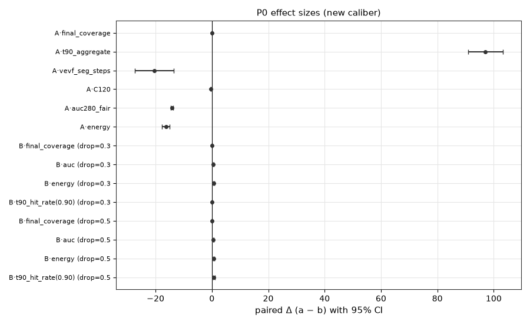
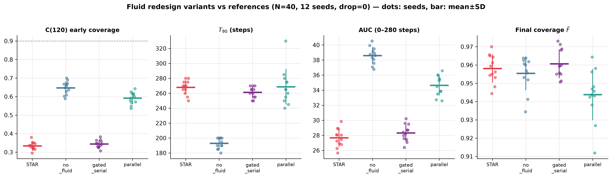
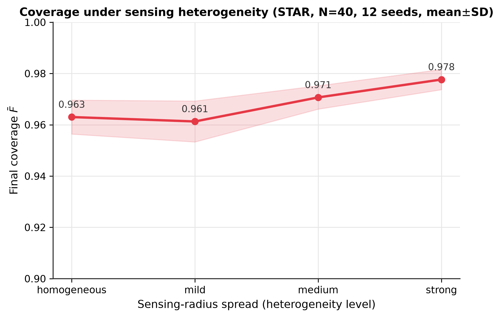

# Supplementary Materials

**Distributed Coverage Control for Heterogeneous USV Swarms with Local Geometric Optimization and Conditional Hole Recovery**

All experiments use paired seeds, run on the corrected implementation (density-pressure SPH fluid at the force-calibrated $k_{fluid}=1.9367\times10^6$; simulator neighbor-cache timing fix; repaired distributed hole recovery), and do not retune any mechanism parameter. Data sources are listed in §S9; the mechanism-fix record is §S10.

---

## S1. Two-stage control experiment (STAR vs. no-fluid variant)

**Figure S1.** Two-stage control experiment (STAR vs. no-fluid variant, $N=40$, 12 seeds, paired, corrected implementation). **(a)** Coverage convergence $\bar{F}(t)\pm$SD (solid: STAR; dashed: no-fluid; shaded band: fluid stage); the dotted line is the $0.90$ target. **(b)** Paired aggregate comparison: aggregate $T_{90}$; STAR's VEVF-segment duration vs. the no-fluid variant's full duration; early coverage $C(120)$; total actuation effort.

Full paired statistics (mean difference with 95% CI, Cohen's $d_z$, positive/negative seed counts, Holm-corrected $p$):

| Contrast (no-fluid $-$ STAR unless noted) | $\Delta$ | 95% CI | $d_z$ | seeds | $p_{\mathrm{Holm}}$ |
|---|---|---|---|---|---|
| Final coverage (STAR $-$ no-fluid) | $+0.007$ | $[+0.001, +0.013]$ | $0.71$ | 8/12 positive | $0.033$ |
| VEVF-segment duration (STAR) vs. full duration (no-fluid) | $-20.4$ steps | $[-27.4, -13.4]$ | $-1.9$ | 0/12 negative | $<10^{-4}$ |
| Early coverage $C(120)$ | $-0.407$ | $[-0.425, -0.388]$ | $-14.1$ | 0/12 positive | $<10^{-3}$ |
| Horizon-matched AUC | $-14.2$ | $[-14.6, -13.7]$ | $-20.9$ | 0/12 positive | $<10^{-3}$ |
| Total actuation effort | $-16.3$ | $[-17.6, -15.0]$ | $-7.9$ | 0/12 positive | $<10^{-3}$ |

These contrasts concern VEVF-stage duration, end-state quality, and actuation effort under identical 280-step VEVF horizons; they do not extend to total deployment time (dominated by the fixed warm-up) or to early spatial spread.

## S2. Hole filling under packet loss (12 seeds, paired)

**Figure S2.** Hole-fill on/off under packet loss ($N=40$, 12 seeds, paired, corrected implementation). **(a,b)** Per-seed final coverage with hole filling ON vs. OFF at $30\%$ and $50\%$ loss (diagonal: parity; every seed lies above it). **(c)** Paired $\Delta$coverage and $\Delta$AUC (ON $-$ OFF) at both loss rates.

- $30\%$ loss: ON $0.955\pm0.008$ vs. OFF $0.930\pm0.008$ ($\Delta=+0.025$, $p<10^{-5}$; 12/12 seeds positive).
- $50\%$ loss: ON $0.902\pm0.012$ vs. OFF $0.865\pm0.014$ ($\Delta=+0.036$, $p<10^{-5}$; 12/12 seeds positive).
- AUC $\Delta=+0.51$/$+0.57$ (both $p<10^{-5}$); energy premium $\approx+0.7$.
- $0.90$-target hit rate at $50\%$ loss: $9/12$ (ON) vs. $0/12$ (OFF).
- $p_{\mathrm{Holm}}<10^{-4}$ within the family.

## S3. Effect-size forest

**Figure S3.** Effect-size forest across all control contrasts of Sections 4.2, 4.8, and 4.9: paired mean difference with $95\%$ confidence interval (A: STAR $-$ no-fluid; B: hole-fill on $-$ off, by loss rate). Asterisks: Holm-corrected $p<0.05$ within each family.

## S4. Fluid-stage redesign study (historical design evidence)

**This study was run on the pre-correction implementation** (12 seeds, $N=40$, drop-free) and served as design evidence motivating the corrected architecture; it is not a validation of the corrected code and its absolute numbers are not comparable to the main text.

**Figure S4.** Fluid-stage redesign study (pre-correction implementation, $N=40$, 12 seeds, drop-free; dots: individual seeds, bars: mean$\pm$SD). Early coverage $C(120)$, aggregate $T_{90}$, horizon-matched AUC, and final coverage for full STAR (un-gated reference), the no-fluid variant, the gated-serial variant (density gate restored), and the parallel fluid–VEVF superposition.

- **Density gate is beneficial.** Gated-serial reached the target $6.7$ steps earlier than the un-gated reference ($261.3\pm7.4$ vs. $267.9\pm9.4$; $d_z=-1.50$, $p_{\mathrm{Holm}}<0.001$), converted its early phase into more coverage ($C(120)$ $\Delta=+0.010$, $d_z=2.6$; horizon-matched AUC $\Delta=+0.64$, $d_z=3.6$, both $p_{\mathrm{Holm}}<10^{-5}$), and left final coverage unchanged, at a small energy premium.
- **Parallel fluid–VEVF superposition is rejected.** Strictly worse than the no-fluid reference on every aggregate metric (final coverage $0.944\pm0.014$ vs. $0.956\pm0.009$; AUC $34.6\pm1.3$ vs. $38.6\pm1.1$; $T_{90}$ $+75.8$ steps). Neither variant produced unsafe configurations (minimum inter-USV distance $10.6$ m over all runs).

## S5. Hole operating-regime sweep (H2) and communication-isolated hole (H4)

**Figure S5.** Hole-fill operating regime (3 seeds, paired). **(a,b)** Isolated-hole area and largest uncovered component over the recovery horizon (hole-fill OFF vs. ON; 3-seed mean). **(c)** Detection and recovery-success rates. **(d)** Residual hole area and final coverage at the end of the recovery window.

- **H2 sweep**: $N\in\{20,30,40\}$; injected hole diameters $500$–$2500$ m at center/boundary/sparse-edge positions; 3 seeds; 270 recovery runs. Detection $100\%$ throughout. With sufficient redundancy ($N\ge30$) hole filling reduces residual hole area by $11$–$43\%$ and raises final coverage by $0.008$–$0.010$, at the cost of $5$–$15\%$ slower recovery. At $N=20$ neither variant recovers the injected holes.
- **H4 isolated hole** (3 seeds): USVs nearest the hole center removed until the nearest remaining USV was $3.09$–$3.39$ km from the center ($>C_{th}=3$ km), leaving a $19$–$24$ km$^2$ uncovered region. VEVF alone failed in 2 of 3 seeds (residual $5.9$–$6.2$ km$^2$ after 300 steps); hole filling recovered in 3 of 3 ($109$–$112$ steps; final coverage $+0.026$–$0.028$). On the one seed where VEVF recovers unaided, hole filling adds energy ($+16$) without net benefit. **Sample-size caveat**: this is a 3-seed single-geometry experiment; the factorial of S7 supersedes its strong version.

## S6. Dense-initialization regime (F4)

**Figure S6.** Dense-initialization operating regime (5 seeds, paired): overlap ratio and cluster radius over time, escape time past a $2000$ m cluster-radius threshold, $T_{50}/T_{90}$, final coverage, and minimax gap vs. launch cluster radius (VEVF-only vs. fluid+VEVF).

- VEVF alone crosses a $2000$ m cluster radius in $30$–$76$ steps vs. $139$–$150$ for the fluid arm (fluid arm at step 120: cluster radius $1.4$–$1.7$ km, overlap $4.6$–$4.9$; VEVF-only: $3.0$–$4.0$ km, overlap $\approx1$–$1.7$).
- Fluid benefit confined to final-quality micro-gains at the densest launches ($+0.012$–$0.014$ coverage, $-20$ m gap for radii $\le1000$ m; vanishing at $1500$ m); $T_{90}$ $+60$–$110$ steps at all radii.

## S7. Hole-fill $2$-factor factorial (H6)

**Design**: 5 paired seeds; defect isolation $d/C_{th}\in\{0.7,0.9,1.0,1.1,1.3\}$ $\times$ target hole diameter $D\in\{3000,4000,5000,6000\}$ m; $N=40$ stable VEVF layout; 300-step recovery; construction prior fixed (isolation lower bound from removing all USVs within $d_{target}$; achieved $d$ recorded honestly).

**Figure S7.** Hole-fill $2$-factor factorial (5 seeds, paired): recovery success rate (OFF vs. ON) and final-coverage gain (ON $-$ OFF) across $d/C_{th}\times D$. The transition regime ($d/C_{th}\approx0.9$–$1.0$, moderate $D$) is the only success-rate gain window; the capacity-limited corner fails under both variants; detection is $100\%$ everywhere.

**Success rate (OFF/ON) and coverage gain by condition** (5-seed means; $D=3$k/4k/5k/6k m):

| $d/C_{th}$ | achieved $d$ | OFF success | ON success | success gain | cov gain (ON$-$OFF) |
|---|---|---|---|---|---|
| 0.7 | 2249 m | 1.0/1.0/0.4/0.4 | 0.8/1.0/0.2/0.2 | $-0.2$/0/$-0.2$/$-0.2$ | $+0.002$/$+0.009$/$+0.004$/$-0.005$ |
| 0.9 | 2751 m | 0.2/0.2/0.2/0.2 | 0.2/0.2/0.6/0.2 | 0/0/**+0.4**/0 | $+0.006$/$+0.006$/$+0.010$/$+0.003$ |
| 1.0 | 3176 m | 0.2/0.2/0.2/0.0 | 0.0/0.0/0.0/0.0 | $\le0$ | $+0.011$/$+0.011$/$+0.011$/$+0.004$ |
| 1.1 | 3369 m | 0.0 ×4 | 0.0 ×4 | 0 | $+0.012$/$+0.012$/$+0.012$/$+0.007$ |
| 1.3 | 3976 m | 0.0 ×4 | 0.0 ×4 | 0 | $+0.006$ ×4 |

Key facts: detection rate $1.000$ at all 20 conditions $\times$ 5 seeds $\times$ 300 steps; final-coverage gain positive in 19/20 conditions ($+0.002$–$+0.012$); ON energy $+10$–$18\%$ in all conditions; oscillations confined to the $d=0.7$ redundant zone. Interpretation: two gates jointly determine recovery value — (i) the defect must approach or exceed the reach of local cell forces ($d/C_{th}\to1$), and (ii) the remaining fleet's coverage capacity must suffice for the defect size. Gate (i) alone: useful propulsion (positive coverage gain). Gates (i)+(ii): success-rate gains (only $d{=}0.9\times D{=}5000$ in this factorial). Neither: both variants fail (capacity boundary, not a mechanism defect). Relation to H4: direction consistent, strong version (success-rate superiority) downgraded to the narrow window above.

## S8. Full parameter table

### S8.1 Consolidated symbol table (moved from the main-text Notation paragraphs)

| Symbol | Meaning | Defined |
|---|---|---|
| $N$, $u_i$, $\mathbf{x}_i$, $\mathbf{v}_i$, $r_i$ | fleet size; USV; position; velocity; sensing radius | §3.1 |
| $C_{th}$ | communication radius | Assumption 1 |
| $\Delta t$, $v_{\max}$, $\mathbf{F}_i(k)$ | time step; speed cap; control force | Eq. (1) |
| $\delta_g$, $C(k)$, $\rho$ | evaluation grid resolution; coverage ratio; sensing surplus | Eqs. (2)–(3) |
| $h$, $W$, $q$, $\mathcal{N}_i^{h}$ | fluid interaction radius; cubic-spline kernel (truncated at $q{=}1$, $W{=}0$ beyond); kernel-range neighbor set | Eqs. (4)–(5) |
| $\rho_0$, $k_{fluid}$, $p_i$ | rest density (gate); pressure gain; pressure | Eq. (6) |
| $\mu$, $c_d$, $\mathbf{F}_i^{bnd}$ | XSPH viscosity; quadratic drag; boundary spring | Eqs. (7)–(8) |
| $d_L$, $\mathcal{V}_i$, $\mathcal{N}_i^{C}$ | power distance; local Laguerre cell; communication-range neighbor set | Eqs. (9)–(10) |
| $\mathbf{c}_i$, $\hat{r}_i$, $\mathbf{m}_i$ | cell centroid; covering radius; MiniMax point (iteratively refined approximation) | §3.3 |
| $k_v/k_c/k_e$, $f_{\max}$, $k_{target}$ | VEVF gains (force per km of displacement); force cap; hole-filling gain | Eqs. (12)–(16) |
| $r_{eff}$, $\mathcal{G}_i^{local}$, $\mathcal{U}_i$ | effective search radius $\min(R_{search}, C_{th})$; local sampling grid; local deficit set | Eq. (15) |
| $T_{90}$, AUC, $\bar{\phi}$, $E$, $\gamma$, $J$, $G$ | convergence time; coverage AUC; neighbor fraction; actuation effort; effort conversion; Jain fairness; minimax gap | Eqs. (17)–(21), §3.6 |
| $N_{fluid}$, $N_{evfa}$, $K$ | stage budgets; total steps | §3.5 |

| Group | Parameter | Value |
|---|---|---|
| Environment | ROI width $\times$ height | $10{,}000\times10{,}000$ m |
| | evaluation grid $\delta_g$ | $250$ m ($400$ m at $N{=}100$; $500$ m at $N\ge150$) |
| USV | number $N$ | $100$ (default), $20$–$300$ (scalability) |
| | radius classes | high $1500$ m (20%) / medium $1000$ m (50%) / low $500$ m (30%) |
| | $v_{\max}$ | $200$ m/s = $20$ m per step ($\Delta t=0.1$; §4.1) |
| | launch | Gaussian cluster, $\sigma=0.15\cdot\min(W,H)/2$ |
| Communication | $C_{th}$ | $3000$ m (default; swept $500$–$5000$ m) |
| | packet loss | Bernoulli per link per step (swept $0$–$0.5$) |
| Simulation | budget | fluid $120$ + VEVF $280$ steps (default); unified $60+140=200$ at $N\ge100$ |
| Fluid | $h$ (interaction radius) | $1500$ m |
| | $k_{fluid}$ | $1.9367\times10^6$ (force-scale calibration, factor $5533$ vs. legacy) |
| | $\rho_0$ (rest density) | $1.4\times10^{-6}$ |
| | $\mu$ (XSPH viscosity) | $25$; drag $c_d=0.06$; boundary $k=2.0$ |
| VEVF | $k_v$/$k_c$/$k_e$ | $500$/$400$/$300$ |
| | $f_{\max}$ | $600$ |
| Hole recovery | $k_{target}$ / $f_{max}$ | $500$ / $600$ |
| | grid res. / search radius | $500$ m / $3000$ m (effective $=\min(R_{search},C_{th})$) |
| | conflict radius | $0.3\times$ self radius (default) |
| Statistics | seeds | 12: {42, 7, 123, 2024, 555, 777, 1000, 2025, 666, 314, 2026, 888}; 3–5 for factorial regime studies |
| | tests | paired $t$ + Wilcoxon signed-rank; Holm correction per family |

## S9. Data archive map

All paths are relative to the repository root (the self-contained submission package).

- Main suites: `results/suite/all_runs.csv` (12-seed × 5-method; STAR rows = corrected implementation; baseline rows bit-identical to the pre-correction archive `results/all_runs_v4.csv`).
- Sweeps: `results/demo_figs/sweep_all.csv` (baselines; scalability rows = unified 200-step budget) and `results/suite_starfix/` (STAR scalfix rows; old-vs-new comparison table).
- Control experiments: `results/p0_analysis_v2/paired_stats.csv` (S1/S2 statistics), `results/p0_controls/` (raw $2\times2$ hole-fill $\times$ loss runs), `results/p3_fluid_redesign/` (S4 historical design study).
- Mechanism regime studies: `results/mech_verify/` — `step4/` (H2/H3), `step5/` (F4/H4), `F6/`, `H6/` (per-run CSVs, time series, reports); runners `run_mech_verify.py`/`run_step4.py`/`run_step5.py`/`run_f6.py`/`run_h6.py` and figure scripts `make_figures_*.py` at the repository root, with per-experiment configurations `configs/step4|step5|f6|h6.yaml`.
- Mechanism-fix record: `results/mechanism_fix/` (audits, 13 unit tests, 60-case regression, report); regression driver `run_mechanism_regression.py`; unit tests `tests/test_mechanism.py`.
- Figure scripts: `figures/make_figures_sci.py` (main figures).

## S10. Sensing-heterogeneity sensitivity (F-series)

**Figure S10.** Coverage under sensing heterogeneity (STAR, $N=40$, 12 seeds, mean±SD) across homogeneous ($0.963$), mild ($0.961$), medium ($0.971$), and strong ($0.978$) sensing-radius spreads.

Coverage stays in the narrow $0.961$–$0.978$ band across all four radius-spread levels; the non-monotonic dip at the mild level is marginal ($0.961$ vs. $0.963$ homogeneous). The dip reflects the barrier effect: with a small radius spread, the Euclidean-like misallocation persists while the surplus is not yet sufficient to compensate it, whereas under medium-to-strong heterogeneity the power-distance head start of large-radius USVs re-balances the partition and converts sensing disparities into appropriate cell-area allocation rather than blind spots. This sweep justifies treating heterogeneity as a second-order sensitivity rather than a primary performance axis in the main text.

## S11. Mechanism-fix record (summary)

Four corrections were applied to the released implementation and validated before all reported experiments: (1) simulator neighbor-cache timing (broadcast $\to$ force $\to$ integrate; first-step zero-force defect removed); (2) fluid stage rewritten as density $\to$ pressure $\to$ force SPH with an explicit rest-density gate and symmetric pairwise forces, force-scale-calibrated against the legacy heuristic; (3) hole recovery repaired (deficit-gated trigger, circular $C_{th}$-clipped search window, stable conflict resolution); (4) phase-level metric recording added. Validation: 13 unit tests (`tests/test_mechanism.py`) and a 60-case before/after regression in which all baseline cases are bit-identical. Full details: `results/mechanism_fix/{code_audit_before,code_audit_after,unit_test_report,regression_report}.md`.
